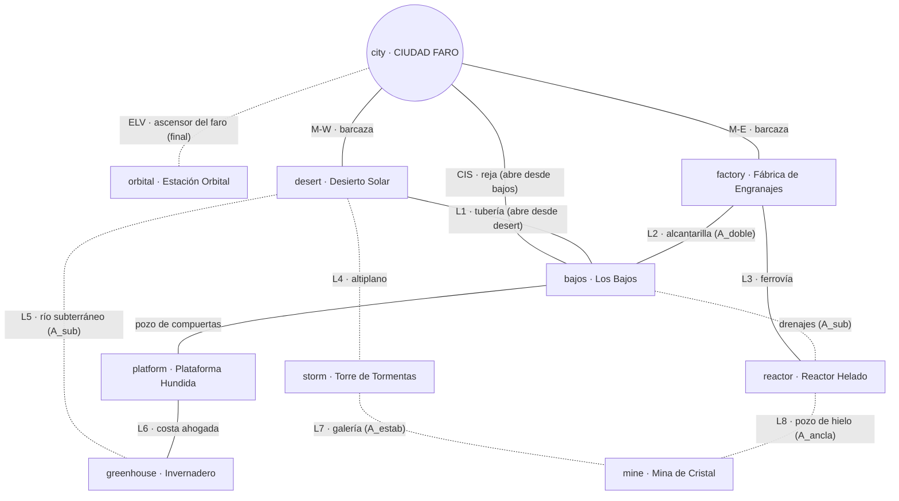
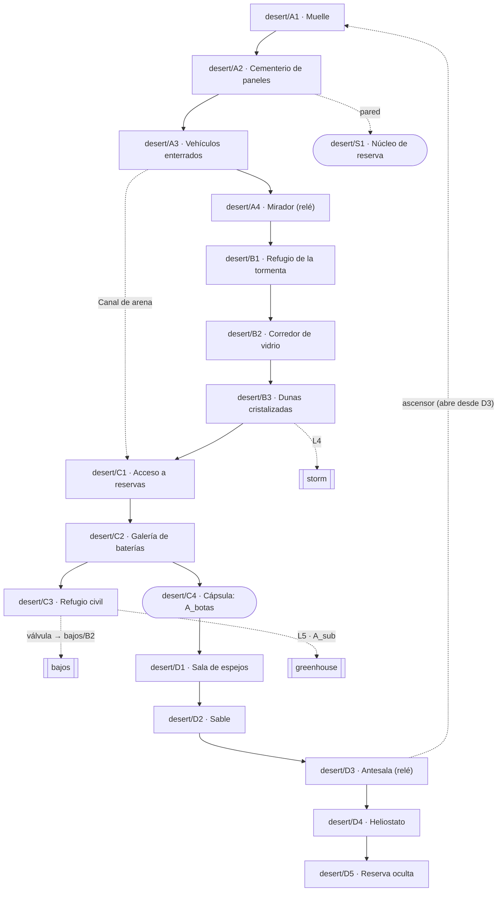

# WORLD_MAP — Ciudad Faro: El Último Eco

Estructura del mundo interconectado, sincronizada con el diseño aprobado de la Issue #1 (PR #3).
**Fuente detallada:** `docs/design/ISSUE-1_TOPOLOGIA_DEL_MUNDO.md`. Ahí están el grafo completo de salas, los recorridos demostrables y los casos de prueba CP-01 a CP-07. Si este resumen y ese documento no coinciden, manda el documento de diseño y la diferencia se corrige aquí.

---

## 1. Vista general

### 1.1 Geografía
- **Ciudad Faro (`city`):** flota en el centro del mar, anclada sobre ruinas sumergidas. Es el punto de partida y de regreso.
- **Oeste · Desierto Solar (`desert`):** meseta alta. Al norte se alza la **Torre de Tormentas (`storm`)**.
- **Este · Fábrica de Engranajes (`factory`):** isla industrial. Una ferrovía sube al noreste, hasta el **Reactor Helado (`reactor`)**.
- **Debajo de la ciudad · Los Bajos (`bajos`):** la ciudad vieja hundida, región conectora.
- **Sur, bajo el mar · Plataforma Hundida (`platform`).**
- **Suroeste · Invernadero Biomecánico (`greenhouse`),** en una costa ahogada.
- **Norte · Mina de Cristal (`mine`),** entre la Torre y el Reactor.
- **Arriba · Estación Orbital (`orbital`),** por el ascensor del faro.

### 1.2 Diagrama de regiones

Línea continua: accesible con el kit base (puede requerir una bandera). Línea punteada: exige una habilidad avanzada.

### 1.3 Principios de la topología
1. La ciudad está en el centro y debajo de todo.
2. Cada región tiene al menos dos entradas. **Excepción intencional:** la Estación Orbital, clímax con una sola entrada (el ascensor del faro).
3. Los atajos se abren desde el lado difícil.
4. Se ven lugares antes de poder alcanzarlos.
5. Habilidades centrales para avanzar; armas de guardianes solo para rutas opcionales.

### 1.4 Identificadores estables
- **Salas:** `región/código` (`city/P1`, `desert/C3`, `bajos/B2`).
- **Conexiones:** `link/M-W`, `link/M-E`, `link/CIS`, `link/ELV` y laterales `link/L1`–`link/L8`.
- **Circuitos:** `loop-west`, `loop-east`, `loop-north`, `loop-south`.
- **Habilidades:** `A_botas`, `A_doble`, `A_sub`, `A_ancla`, `A_linterna`, `A_estab`; objeto `K_llave`.
- **Banderas:** `F_lila`, `F_intro`, `F_porton`, `F_valvula`, `F_reja`, `F_ascensor_d3`, `F_desierto`, `F_paneles`, `F_fabrica`, `F_sable`, `F_tarjeta`.

Estos IDs son estables: el código, los datos de salas y el validador usarán los mismos nombres.

---

## 2. Ciudad Faro

### 2.1 Introducción (antes del Desierto Solar)
| Sala | Función | Enseña |
|---|---|---|
| `city/T0` · Taller sellado | Despertar del piloto en el taller abandonado de la ingeniera | Correr, saltar |
| `city/T1` · Conductos del faro | Subida vertical; se ve el ascensor del faro sin energía | Pared |
| `city/M1` · Mercado apagado | Primer combate; aparece **Nox** | Disparo, disparo cargado |
| `city/BA1` · Barrio Apagado | **Se conoce a Lila en persona** (`F_lila`) | Dash |
| `city/P1` · Plaza del Faro | Lila explica la situación; relé `relay/plaza`; se abre el portón al mercado (`F_porton`); `F_intro` | — |
| `city/O1` · Muelle Oeste | Barcaza al Desierto Solar (recomendado por Lila) | — |
| `city/E1` · Muelle Este | Barcaza a la Fábrica | — |
| `city/CI1` · Cisterna | Reja cerrada hacia Los Bajos; se abre desde abajo (`F_reja`) | — |
| `city/F1` · Base del faro | Ascensor a la Estación Orbital (final) | — |

**Encuentro obligatorio con Lila:** la ruta es lineal `city/M1` → `city/BA1` → `city/P1`. El portón M1 ↔ P1 está encadenado y solo se abre desde la plaza, así que `F_intro` implica `F_lila`. Después, la exploración entre esas salas es libre.

### 2.2 Zonas de la base
| Zona | Función | Disponible |
|---|---|---|
| Taller de Lila | Mejoras, conversaciones, mapa | Tras la introducción (ubicación exacta por definir) |
| Plaza del Faro (`city/P1`) | Centro social; cambia según la energía recuperada | Desde la introducción |
| Barrio Apagado (`city/BA1`) | Familia de Lila; se ilumina (o no) según tus decisiones | Desde la introducción, a oscuras |
| Mercado (`city/M1`) | Tienda y misiones de habitantes | Existe desde la introducción; **abre** cuando el desierto vuelve a dar energía |
| Cisterna (`city/CI1`) | Paso a Los Bajos | Al abrir la reja desde `bajos/B1` |
| Base del faro (`city/F1`) | Ascensor a la Estación Orbital | Final (`A_estab` y `K_llave`) |

### 2.3 Cambios visibles al regresar
| Estado | Cambio |
|---|---|
| `F_desierto = pendiente` | La plaza sigue a oscuras; Lila lo comenta. Nada finge que el desierto esté resuelto |
| `F_desierto = ciudad` | Se encienden los faroles de la plaza, abre el mercado, el Barrio Apagado recupera luz; la radio anuncia un corte en un asentamiento "fuera de los registros" |
| `F_desierto = refugio` | Faroles de la plaza encendidos; el barrio sigue a medias; Dante aparece en el mercado |
| `F_paneles` (0–4) | Modula la intensidad de las luces en cualquiera de las dos opciones |
| `F_reja` | Los vecinos usan el pasaje; un habitante nuevo cuenta historias de Los Bajos |
| Primer regreso | Cameo de **Silas** en la plaza |

---

## 3. Los Bajos (región conectora)

Las calles de la ciudad vieja, hundidas bajo Ciudad Faro: faroles bajo el agua, letreros de comercios que ya no existen y una comunidad que no aparece en el censo. Tiene enemigos propios (bombas de achique agresivas, cangrejos de mantenimiento), secretos e historias. **No es una autopista:** tiene un solo relé y el viaje rápido nunca une dos puntos de Los Bajos.

| Sala | Estado | Conecta con | Requisito |
|---|---|---|---|
| `bajos/B1` · Cisterna | Seca | `city/CI1` (reja), `bajos/B3` | La reja se abre desde aquí (`F_reja`) |
| `bajos/B2` · Galería de válvulas | Seca | `desert/C3` (L1), `bajos/B3` | `F_valvula` |
| `bajos/B3` · Colector central | Seca | B1, B2, B4, B5, B6 | — · `relay/colector` |
| `bajos/B4` · Pozo de compuertas | Seca | B3, `platform/P1` | — |
| `bajos/B5` · Alcantarilla de escoria | Seca | B3, `factory/F4` (L2) | `A_doble` para subir a la Fábrica |
| `bajos/B6` · Depósito inundado | Inundada | B3, `reactor/R3` (drenajes) | `A_sub` |

---

## 4. Conexiones, circuitos y relés

### 4.1 Conexiones entre regiones
| ID | Origen ↔ destino | Requisito | Dirección | Tipo |
|---|---|---|---|---|
| `link/M-W` | `city/O1` ↔ `desert/A1` | `F_intro` | Ambos sentidos | Obligatoria |
| `link/M-E` | `city/E1` ↔ `factory/F1` | `F_intro` | Ambos sentidos | Obligatoria (diseño final; cerrada en la demo, ver §8) |
| `link/CIS` | `city/CI1` ↔ `bajos/B1` | `F_reja` | Abre-desde `bajos/B1` | Opcional (atajo) |
| `link/L1` | `desert/C3` ↔ `bajos/B2` | `F_valvula` | Abre-desde `desert/C3` | Opcional (atajo) |
| `link/L2` | `factory/F4` ↔ `bajos/B5` | `A_doble` | Ambos sentidos | Opcional |
| `link/L3` | `factory/F6` ↔ `reactor/R1` | `A_doble` **o** `F_fabrica` | Ambos sentidos | Obligatoria para el norte por el este |
| — | `bajos/B4` ↔ `platform/P1` | — | Ambos sentidos | Obligatoria para la Plataforma |
| — | `bajos/B6` ↔ `reactor/R3` | `A_sub` | Ambos sentidos | Opcional (segunda entrada) |
| `link/L4` | `desert/B3` ↔ `storm/T1` | (`A_doble` y `A_botas`) **o** `A_ancla` | Ambos sentidos | Obligatoria para la Torre |
| `link/L5` | `desert/C3` ↔ `greenhouse/G4` | `A_sub` | Ambos sentidos | Opcional (segunda entrada) |
| `link/L6` | `platform/P1` ↔ `greenhouse/G1` | — | Ambos sentidos | Obligatoria para el Invernadero |
| `link/L7` | `storm/T5` ↔ `mine/N1` | `A_estab` | Ambos sentidos | Una de dos entradas |
| `link/L8` | `reactor/R5` ↔ `mine/N2` | `A_ancla` | Ambos sentidos | Una de dos entradas |
| `link/ELV` | `city/F1` ↔ `orbital/O1` | `A_estab` y `K_llave` | Ambos sentidos | Obligatoria (final) |

### 4.2 Circuitos de retorno
| ID | Recorrido | Se cierra con |
|---|---|---|
| `loop-west` | Ciudad → Desierto → L1 → Los Bajos → Cisterna → Ciudad | `F_valvula` + `F_reja` |
| `loop-east` | Ciudad → Fábrica → L3 → Reactor → drenajes → Los Bajos → Cisterna → Ciudad | `A_sub` (+ `F_reja`) |
| `loop-north` | Desierto → L4 → Torre → L7 → Mina → L8 → Reactor → L3 → Fábrica → Ciudad | `A_estab` + `A_ancla` |
| `loop-south` | Los Bajos → Plataforma → L6 → Invernadero → L5 → Desierto | `A_sub` |

### 4.3 Relés del faro (punto de control y viaje rápido)
| Relé | Sala | Alcanzable cuando… |
|---|---|---|
| `relay/plaza` | `city/P1` | Desde la introducción |
| `relay/mirador` | `desert/A4` | Al llegar al desierto |
| `relay/corazon` | `desert/D3` | Tras la sala de espejos (`A_botas`) |
| `relay/colector` | `bajos/B3` | Al entrar a Los Bajos |
| `relay/hangar` | `platform/P2` | Al llegar al hangar de presión |
| Resto | — | Se definirán con cada región |

Cada relé reactivado es punto de control, destino de viaje rápido y transmite el contorno de su región al mapa.

---

## 5. Habilidades y bloqueos

### 5.1 Habilidades centrales (garantizan completar el juego)
| Habilidad | Dónde se obtiene | Abre |
|---|---|---|
| Dash, pared, disparo cargado | Desde el inicio | Movimiento básico |
| Botas de impulso (`A_botas`, dash aéreo) | `desert/C4`, cámaras de reserva | Huecos anchos, sala de espejos, parte de L4 |
| Doble impulso (`A_doble`) | Fábrica de Engranajes | Paredes altas, L2, L3, mirador del altiplano |
| Movilidad submarina (`A_sub`) | `platform/P2`, hangar de presión (zona seca) | Zonas inundadas; L5 y drenajes |
| Anclajes magnéticos (`A_ancla`) | Reactor Helado | Techos y cruces largos; L4 (alternativa) y L8 |
| Linterna de resonancia (`A_linterna`) | Invernadero; **modo de la mochila-faro** | Disuelve los velos del Eco (núcleo de la Mina) |
| Estabilizador (`A_estab`, atravesar corrientes) | Torre de Tormentas | Corrientes de aire y agua; L7; ascensor final |
| Llave del faro (`K_llave`, objeto) | Núcleo de la Mina de Cristal (exige `A_linterna`) | Ascensor del faro |

Cómo se llega a cada una (rutas mínimas y alternativas): §4.3 del documento de diseño.

**Dependencias (sin ciclos):**
```
Base ─┬─► A_botas
      ├─► A_doble
      └─► F_valvula ──► A_sub                 [alternativa: A_doble → L2]
A_doble ∨ F_fabrica ∨ A_sub ─► A_ancla
F_valvula ∨ A_doble ─► Plataforma ─► A_linterna
(A_doble ∧ A_botas) ∨ A_ancla ─► A_estab
(A_estab ∨ A_ancla) ∧ A_linterna ─► K_llave
A_estab ∧ K_llave ─► Estación Orbital
```

### 5.2 Armas de guardianes (rutas alternativas y secretos)
Rayo Solar (derrite bloqueos de vidrio) · Lanza de Escarcha (plataformas de hielo) · Pulso Abisal (compuertas) · Raíz Viva (anclajes orgánicos) · Pulso Magnético (mecanismos) · Arco Voltaico (circuitos) · Haz Prismático (rebotes) · Campo Gravitacional (trayectorias).

### 5.3 Posponer un guardián
Se puede explorar otras regiones antes de vencer a un guardián. Ejemplo aprobado: abrir la válvula de `desert/C3` antes de Heliostato permite ir a Los Bajos, la Plataforma y más allá. Mientras tanto:
- `F_desierto = pendiente`: la arena, la revelación de `desert/D5` y la decisión siguen esperando.
- La ciudad no cambia por el desierto; los guardianes posteriores comentan que sigue apagado.
- La escena final de Dante no ocurre hasta resolverlo.
- El primer hito no se considera completo sin vencer a Heliostato.

### 5.4 Reglas anti-bloqueo
- Toda ruta **obligatoria** se abre solo con habilidades centrales y banderas que se obtienen con ellas.
- Las armas abren únicamente rutas **opcionales**, atajos y secretos.
- Puertas, atajos y palancas quedan abiertos para siempre y se guardan al activarse.
- Ninguna puerta se cierra detrás del jugador sin una salida alternativa; las arenas de jefe tienen salida después de la pelea.
- **Validador de rutas:** recorrerá el grafo de salas para cada conjunto de habilidades y banderas. Hasta que exista y se ejecute, **no se afirma la ausencia de bloqueos** (hoy solo hay revisiones manuales).

---

## 6. Leyenda del mapa en el juego

| Símbolo | Significado |
|---|---|
| Sala iluminada | Visitada |
| Sala gris | Vista pero no visitada |
| Puerta con icono | Bloqueada; el icono indica la habilidad o bandera necesaria |
| Ancla dorada | Relé del faro (punto de control y viaje rápido) |
| Rombo cian | Secreto encontrado |
| Signo de interrogación | Secreto detectado, no alcanzado |

---

## 7. Desierto Solar (detalle)

Región inicial. Ruta crítica estimada de 20–26 minutos (más 8–13 de exploración), dentro de la meta del primer hito (§8).



| Área | Salas | Introduce | Requisito |
|---|---|---|---|
| A · Cementerio solar exterior | A1–A4, S1 | Correr, disparar, saltar, dash, pared | Ninguno |
| B · Tormenta de vidrio | B1–B3 | Viento, refugios, enemigos que usan el clima | Ninguno |
| C · Cámaras de reserva | C1–C4 | Refugio civil (Dante, robot farolero), válvula a Los Bajos, Botas de impulso | Ninguno para entrar |
| D · Corazón de la estación | D1–D5 | Espejos de energía, Sable, Heliostato, decisión | `A_botas` para la sala de espejos |

**Atajos:** ascensor `desert/D3` → `desert/A1` (`F_ascensor_d3`, se abre desde D3) y válvula `desert/C3` → `bajos/B2` (`F_valvula`).

**Sable:** su primera escena ocurre en la antesala del primer guardián que alcance el jugador (aquí `desert/D2` si el desierto va primero); el reconocimiento, en la siguiente. Hay una sola escena por antesala, con variantes de diálogo según `F_sable`.

**Heliostato:** fase 2 con los paneles de la arena. Antes de decidir, el juego avisa (placa en `desert/D3`, medidor "Reserva recuperable", línea de Lila) de que romper paneles reduce la energía recuperada. Las consecuencias combinan `F_paneles` y `F_desierto`, sin bloquear contenido obligatorio.

### Secretos del Desierto Solar
| Secreto | Ubicación | Requiere |
|---|---|---|
| Núcleo de reserva (+4 energía) | `desert/S1`, sobre A2 | Pared |
| Grabación de la ingeniera #1 | Camión enterrado en `desert/A3` | Rayo Solar (al volver) |
| Fragmento 1 | Bajo las dunas de `desert/B3` | `A_botas` |
| Diario del robot farolero | `desert/C3` | Hablar con él en tres visitas |
| Cámara sellada de vidrio | Junto a `desert/C2` | Rayo Solar |
| Mirador del altiplano | Arriba de `desert/B3` | `A_doble` |

---

## 8. Primer hito «La primera luz»: demo frente a diseño final

| Elemento | Demo / primer hito | Diseño final |
|---|---|---|
| Muelle Este | Cerrado: "barcaza en reparación" (**solo en la demo**) | Abierto tras la introducción |
| Los Bajos | `bajos/B1`–`B3` y la válvula | Seis salas (B1–B6) |
| Regiones | Ciudad introductoria + Desierto Solar completo | Las diez regiones |
| Relés | `relay/plaza`, `relay/mirador`, `relay/corazon`, `relay/colector` | Todos |

**Metas de duración (aprobadas, pendientes de medir en partidas reales):** 35–45 minutos de ruta principal; 50–65 minutos con exploración opcional.

---

## 9. Cambios respecto a la versión anterior de este documento
| Antes | Ahora |
|---|---|
| Progresión ascendente por pares de regiones | Topología interconectada con la ciudad en el centro |
| Sin región conectora; "pasadizos bajo los pontones" | Los Bajos, seis salas (ver §3) |
| Muelle de llegada con barcazas, teleférico y ascensor | Muelle Oeste, Muelle Este y ascensor del faro (el teleférico queda fuera del diseño actual) |
| Mercado disponible "tras la Estación 1" | El mercado existe desde la introducción y abre cuando vuelve la energía |
| Anclajes magnéticos en el taller tras 4 estaciones | Anclajes en el Reactor Helado |
| Seis habilidades centrales | Siete habilidades más la Llave del faro |
| Ruta del fondo de C3 al Reactor con Lanza de Escarcha | C3 conecta con Los Bajos (válvula) y con el Invernadero (`A_sub`) |
| Desierto de 25–40 minutos | Desierto de 20–26 min de ruta crítica; hito de 35–45 / 50–65 min |
| «Lira» | **Lila** |
