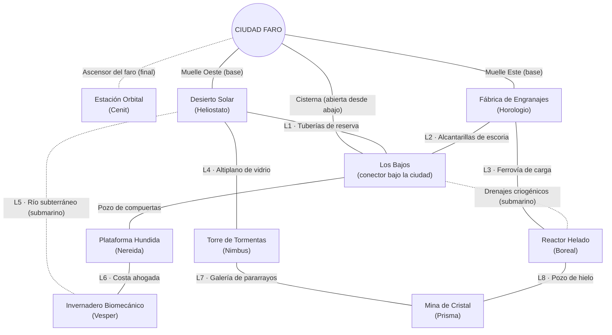
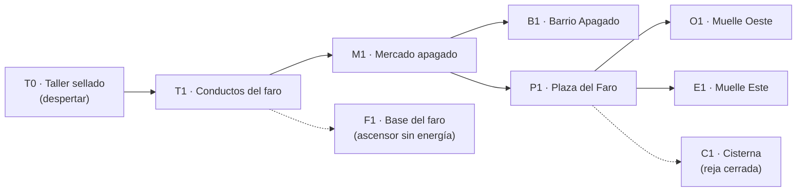
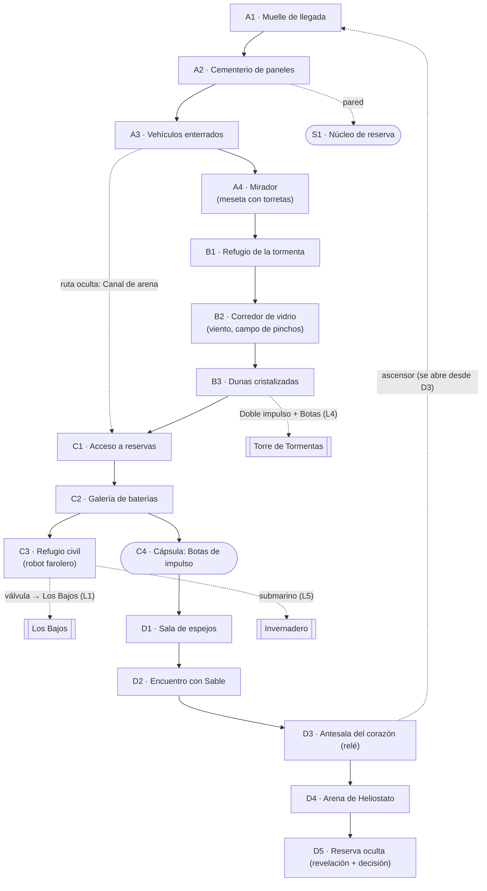

# Issue #1 — Topología del mundo interconectado

**Estado:** propuesta para revisión (ChatGPT) y aprobación (usuario).
**Alcance:** solo diseño. No modifica `index.html`, sistemas jugables ni guardados.
**Inspiración:** principios de exploración de los Metroidvania (mundo continuo, atajos que se abren desde el otro lado, regreso con habilidades nuevas, lugares vistos antes de poder alcanzarlos). No se copian mapas, personajes, arte ni contenido de ningún juego.

---

## 0. Principios de diseño que guían la propuesta

1. **La ciudad está en el centro y debajo de todo.** Ciudad Faro es el punto de partida, el lugar al que se vuelve y la llave final (el ascensor del faro lleva a la Estación Orbital).
2. **Cada región tiene al menos dos entradas.** Una se descubre pronto; la otra se abre después, muchas veces desde dentro.
3. **Los atajos se abren desde el lado difícil.** El jugador ve una puerta o un ascensor bloqueado, cruza la región y lo abre desde el otro lado. Eso convierte el regreso en recompensa.
4. **Mostrar antes de permitir.** Cada habilidad nueva debería hacer recordar al menos un lugar visto antes.
5. **Habilidades centrales para avanzar; armas para explorar.** Ninguna ruta obligatoria exige el arma de un guardián.
6. **Nada se cierra sin salida.** Toda caída de un solo sentido tiene una salida alcanzable con las habilidades que el jugador tiene en ese momento.

---

## 1. Geografía y topología del mundo

### 1.1 Geografía (de dónde sale la forma del mapa)
- **Ciudad Faro** flota en el centro del mar, anclada sobre ruinas sumergidas.
- **Oeste:** la meseta del **Desierto Solar**. Al norte de la meseta se alza la **Torre de Tormentas**, que provoca la tormenta de vidrio del desierto.
- **Este:** la isla industrial de la **Fábrica de Engranajes**. Una vieja ferrovía de carga sube al noreste, hasta el **Reactor Helado**.
- **Debajo de la ciudad:** **Los Bajos**, la infraestructura inundada sobre la que flota la ciudad (tuberías, cisternas, antiguos túneles de mantenimiento). Es la **región conectora** del mundo.
- **Sur, bajo el mar:** la **Plataforma Hundida**.
- **Suroeste:** el **Invernadero Biomecánico**, en una costa ahogada a la que llega un río subterráneo del desierto.
- **Norte, dentro de la montaña:** la **Mina de Cristal**, entre la Torre de Tormentas y el Reactor Helado.
- **Arriba:** la **Estación Orbital**, a la que se llega por el **ascensor del faro**.

### 1.2 Diagrama de regiones



Líneas continuas: conexión principal. Líneas punteadas: conexión que exige una habilidad de movimiento avanzada.

### 1.3 Circuitos de retorno
| Circuito | Recorrido | Cuándo se cierra | Para qué sirve |
|---|---|---|---|
| **C1 · Circuito Oeste** | Ciudad → Muelle Oeste → Desierto → Tuberías de reserva (L1) → Los Bajos → Cisterna → Ciudad | Al abrir la válvula de las tuberías desde el desierto (C3) | Primer gran atajo; une la ciudad con el corazón del desierto sin barcaza |
| **C2 · Circuito Este** | Ciudad → Muelle Este → Fábrica → Ferrovía (L3) → Reactor Helado → Drenajes criogénicos → Los Bajos → Ciudad | Con movilidad submarina | Conecta las dos regiones industriales y muestra que Los Bajos están bajo todo |
| **C3 · Circuito Norte** | Desierto → Altiplano (L4) → Torre de Tormentas → Galería (L7) → Mina → Pozo de hielo (L8) → Reactor → Ferrovía → Fábrica → Ciudad | A mitad de campaña | Gran vuelta por el norte; revela que la tormenta y el hielo comparten una causa |
| **C4 · Circuito Sur** | Los Bajos → Plataforma Hundida → Costa ahogada (L6) → Invernadero → Río subterráneo (L5) → Desierto | Con movilidad submarina | Une el mar con el desierto; acceso alternativo al Invernadero |

### 1.4 Tabla de conexiones entre regiones
| # | Origen | Destino | Requisito | Propósito | Retorno |
|---|---|---|---|---|---|
| — | Ciudad (Muelle Oeste) | Desierto (A1) | Ninguno tras la introducción | Primera salida | Barcaza en ambos sentidos |
| — | Ciudad (Muelle Este) | Fábrica (entrada) | Ninguno tras la introducción | Segunda región inicial | Barcaza en ambos sentidos |
| — | Ciudad (Cisterna) | Los Bajos | Abrir la reja desde Los Bajos | Atajo urbano | Ambos sentidos al abrirse |
| L1 | Desierto (C3) | Los Bajos | Abrir la válvula desde el desierto | Circuito Oeste | Ambos sentidos |
| L2 | Fábrica (alcantarillas) | Los Bajos | Doble impulso (pozo vertical) | Acceso este a Los Bajos | Ambos sentidos |
| L3 | Fábrica (andén) | Reactor Helado | Doble impulso, o restaurar la Fábrica | Tercera región | Vagón en ambos sentidos |
| — | Los Bajos | Plataforma Hundida (parte alta) | Ninguno | Región marina | Ambos sentidos |
| — | Los Bajos | Reactor (drenajes) | Movilidad submarina | Acceso alternativo al Reactor | Ambos sentidos |
| L4 | Desierto (B3) | Torre de Tormentas | Doble impulso + Botas, **o** Ancla magnética | Región avanzada | Ambos sentidos |
| L5 | Desierto (C3, río) | Invernadero | Movilidad submarina | Circuito Sur | Ambos sentidos |
| L6 | Plataforma Hundida | Invernadero | Ninguno desde la parte alta de la Plataforma | Acceso principal al Invernadero | Ambos sentidos |
| L7 | Torre de Tormentas | Mina de Cristal | Estabilizador de corrientes | Zona final | Ambos sentidos |
| L8 | Reactor Helado | Mina de Cristal | Ancla magnética | Zona final (otra entrada) | Ambos sentidos |
| — | Ciudad (base del faro) | Estación Orbital | Estabilizador + Llave del faro (Mina) | Final | Ascensor en ambos sentidos |

Hay **8 conexiones laterales entre regiones** (L1–L8), más que las tres que pide la Issue.

### 1.5 Viaje rápido y mapa
- **Relés del faro:** antenas de señal abandonadas, una o dos por región. Al reactivarlas sirven como punto de control y viaje rápido a otros relés activos. La ciudad tiene uno en la plaza.
- **Mapa:** cada relé reactivado le transmite al Decodificador (ver sección 8) el contorno de la región. Las salas visitadas se completan solas. Los secretos detectados se marcan con "?".

---

## 2. Ciudad Faro introductoria (10–15 minutos)

### 2.1 Salas


| Sala | Qué pasa | Enseña | Recompensa / gancho |
|---|---|---|---|
| **T0 · Taller sellado** | El piloto despierta en el taller abandonado de la ingeniera, bajo el faro. La armadura se activa por primera vez durante un apagón. | Correr, saltar | Primera línea sarcástica; una grabación muy corta de la ingeniera, cortada a la mitad |
| **T1 · Conductos del faro** | Salida vertical por conductos. Se ve, a lo lejos, el ascensor del faro sin energía (F1). | Pared, impulso de pared | Gancho final: "algún día ese ascensor tendrá que funcionar" |
| **M1 · Mercado apagado** | Un dron de mantenimiento infectado por el Eco ataca puestos vacíos. | Disparar, disparo cargado | Conoces al **Decodificador**, que escucha "voces" en la estática |
| **B1 · Barrio Apagado** | La familia de Lira vive a oscuras. Una vecina pide ayuda con un generador. | Dash (hueco corto) | Lira por radio, por primera vez en persona ("No, no estoy llorando. Es el humo del generador.") |
| **P1 · Plaza del Faro** | El faro parpadea. Lira explica la situación de las estaciones. El **Archivista** observa desde un balcón y se va. | — | Relé de la plaza (punto de control). Se elige destino |
| **O1 · Muelle Oeste** | Barcaza al Desierto Solar | — | Recomendado por Lira ("es la más cercana y la menos rara") |
| **E1 · Muelle Este** | Barcaza a la Fábrica | — | Disponible, con aviso de mayor peligro |
| **C1 · Cisterna** | Reja oxidada; se oye agua y una luz cian del otro lado | — | Se abrirá desde Los Bajos (atajo del Circuito Oeste) |

**Ritmo:** T0–T1 (3 min) → M1 (3–4 min) → B1 (2–3 min) → P1 (2–3 min) → muelle. Total: 10–13 minutos sin contar exploración.

### 2.2 Cambios visibles al regresar
| Situación | Cambio en la ciudad |
|---|---|
| Desierto restaurado | Faroles de la plaza encendidos, el mercado abre puestos, llega un comerciante nuevo |
| Decisión del desierto: **toda la energía a la ciudad** | El Barrio Apagado recupera luz; la radio anuncia que un asentamiento "fuera de los registros" perdió suministro |
| Decisión del desierto: **mantener el refugio** | El barrio sigue a medias; el defensor del refugio aparece en el mercado para cambiar piezas; Lira está molesta, pero entiende |
| Fábrica restaurada | Talleres activos, el ascensor de servicio del mercado funciona (atajo interno) |
| Cisterna abierta desde Los Bajos | Los vecinos usan el pasaje; un habitante nuevo cuenta historias de "lo que hay abajo" |

---

## 3. Desierto Solar reestructurado

Se conservan las cuatro áreas (A–D), los elementos que ya existen en el juego (huecos, meseta con torretas, campo de pinchos con plataformas, el Núcleo de reserva en la pared, la cápsula de las Botas y la arena de Heliostato) y se reorganizan en salas.

### 3.1 Diagrama


### 3.2 Conexiones internas
| Origen | Destino | Requisito | Propósito | Retorno |
|---|---|---|---|---|
| A1 | A2 | — | Tutorial de carrera y disparo | Libre |
| A2 | S1 | Pared | Primer secreto (+4 energía); enseña que trepar paga | Caída a A2 |
| A3 | C1 (Canal de arena) | Ver la grieta y romperla con disparo cargado | Ruta oculta que evita la tormenta | Ambos sentidos |
| A4 | B1 | — | La meseta con torretas existente termina en la tormenta | Libre |
| B2 | B3 | — | Campo de pinchos existente, ahora con ráfagas de viento | Libre |
| C2 | C4 | — | Mejora central: Botas de impulso | Libre |
| C3 | Los Bajos | Abrir la válvula (palanca) | Circuito Oeste (C1) | Ambos sentidos |
| D3 | A1 | Activar el ascensor desde D3 | Atajo al punto de llegada | Ambos sentidos |
| D4 | D5 | Vencer a Heliostato | Revelación y decisión | Libre |

### 3.3 Secretos con contenido
| Secreto | Dónde | Requisito | Qué aporta |
|---|---|---|---|
| Núcleo de reserva | S1, sobre A2 | Pared | +4 energía máxima (ya existe en el juego) |
| Grabación de la ingeniera #1 | Camión enterrado en A3 | Rayo Solar (derrite el parabrisas cristalizado) | Primera pista de que las estaciones eran algo más que energía |
| **Fragmento 1** | Bajo las dunas de B3 | Botas de impulso (hueco largo) | Primer fragmento del protocolo de Madre Faro |
| Diario del robot farolero | C3 | Hablar con él tres veces (en visitas distintas) | Historia de la niña que esperaba; momento sin bromas |
| Cámara de vidrio sellada | Junto a C2 | Rayo Solar | Mejora de energía de arma |
| Mirador del altiplano | Arriba de B3 | Doble impulso | Vista de la Torre de Tormentas: muestra el destino antes de poder ir |

### 3.4 Momento narrativo con Sable (D2)
- **Antes:** en B1 se ve una silueta en la tormenta que desaparece (presagio).
- **En D2:** Sable ya desactivó la mitad de la sala de espejos para que nadie llegue a Heliostato.
  > **Sable:** Cada vez que alguien "arregla" una estación, alguien más deja de respirar. Pregúntale a tu jefa por qué no te lo dijo.
  > **Piloto:** No tengo jefa. Tengo una técnica con mal humor y un sueldo inexistente.
- **Duelo corto (no letal):** Sable usa ataques que el jugador ya conoce (dash y disparo) para enseñar a leer patrones. Al llegar a la mitad de su vida, se retira.
- **Consecuencia:** deja caer una tarjeta con el nombre del refugio oculto. Si el jugador la recoge, el diálogo de D5 cambia.

### 3.5 Heliostato y la decisión
- Se mantienen los ataques actuales (salto con ondas, abanico, embestida) con mejor anticipación.
- **Fase 2:** los paneles de la arena concentran rayos. Destruirlos facilita la pelea, pero reduce la energía que se recupera.
- **D5:** la reserva alimentaba un refugio que no figura en los mapas. Allí está el **defensor del refugio** (personaje pendiente de aprobación).
- **Decisión:** toda la energía a Ciudad Faro, o mantener el suministro del refugio. Las consecuencias se ven en la ciudad (sección 2.2).

---

## 4. Matriz de dependencias por habilidad

### 4.1 Habilidades centrales
| Habilidad | Dónde se obtiene | Accesible por | Obligatoria para | Abre (opcional) |
|---|---|---|---|---|
| Base (dash, pared, disparo cargado) | Inicio | — | Todo el comienzo | — |
| **Botas de impulso** (dash aéreo) | Desierto C4 | Base | Corazón del desierto (D1 tiene huecos que las exigen) | Fragmento 1; altiplano (junto con Doble impulso) |
| **Doble impulso** | Fábrica (núcleo de talleres) | Base | Ferrovía al Reactor (L3) | Alcantarillas a Los Bajos (L2); mirador del altiplano |
| **Movilidad submarina** (traje sellado) | Plataforma Hundida, mitad de la región | Base (parte alta de la Plataforma por Los Bajos) | Parte profunda de la Plataforma y Nereida | Drenajes al Reactor; río subterráneo al Invernadero |
| **Ancla magnética** | Reactor Helado | Doble impulso **o** Movilidad submarina | Pozo de hielo a la Mina (L8) | Altiplano a la Torre (L4, alternativa) |
| **Linterna de resonancia** (disuelve velos del Eco) | Invernadero | Movilidad submarina **o** Plataforma alta (L6) | Parte profunda de la Mina de Cristal | Secretos con velos del Eco en todo el mapa |
| **Estabilizador de corrientes** | Torre de Tormentas | Doble impulso + Botas **o** Ancla magnética | Galería a la Mina (L7); cima del ascensor del faro | Corrientes de aire y agua del mapa |
| **Llave del faro** | Mina de Cristal (núcleo) | Ancla **o** Estabilizador, + Linterna | Estación Orbital | — |

### 4.2 Armas de guardianes (nunca obligatorias)
| Arma | Abre |
|---|---|
| Rayo Solar | Vidrio cristalizado (grabaciones, cámaras selladas) |
| Pulso Magnético | Mecanismos y puertas de servicio (atajos) |
| Lanza de Escarcha | Plataformas de hielo sobre agua (rutas cortas) |
| Pulso Abisal | Compuertas oxidadas (secretos marinos) |
| Raíz Viva | Anclajes orgánicos (rutas alternativas en el Invernadero y la costa) |
| Arco Voltaico | Circuitos sin energía (atajos eléctricos) |
| Haz Prismático | Rompecabezas de reflejos (secretos de la Mina) |
| Campo Gravitacional | Rutas alternativas en la Estación Orbital |

### 4.3 Comprobación de que no hay dependencias circulares
```
Base ─┬─► Botas (Desierto)
      ├─► Doble impulso (Fábrica)
      └─► Movilidad submarina (Plataforma, parte alta sin requisito)
Doble impulso ∨ Movilidad ─► Ancla magnética (Reactor)
Movilidad ∨ Plataforma alta ─► Linterna de resonancia (Invernadero)
(Doble impulso ∧ Botas) ∨ Ancla ─► Estabilizador (Torre)
(Ancla ∨ Estabilizador) ∧ Linterna ─► Llave del faro (Mina)
Estabilizador ∧ Llave ─► Estación Orbital
```
Ninguna habilidad exige otra que solo se obtiene después de ella. Cada región intermedia tiene **dos caminos de acceso**.

### 4.4 Reglas para evitar bloqueos (para implementar y validar)
1. Toda ruta obligatoria usa solo habilidades centrales.
2. Las puertas y atajos abiertos quedan abiertos para siempre (se guardan).
3. Toda caída de un solo sentido tiene salida con las habilidades disponibles en ese punto.
4. Las arenas de jefe tienen salida después de la pelea, aunque el jugador haya perdido vidas.
5. Se guarda la partida automáticamente al obtener una habilidad.
6. **Validador de rutas** (herramienta de depuración, Fase 1): para cada conjunto de habilidades en orden de obtención, comprueba con búsqueda en grafo que todas las salas obligatorias sean alcanzables y que cada sala tenga regreso a un relé.

---

## 5. Dos órdenes viables para las primeras regiones

Ambas regiones iniciales se completan solo con el kit base, y cada una tiene zonas opcionales que piden la habilidad de la otra.

### Orden A — Desierto primero (recomendado por Lira)
1. Ciudad → **Desierto Solar** (Botas) → regreso por el Circuito Oeste → **Fábrica** (Doble impulso) → Plataforma o Reactor.
- **Mecánica:** el desierto es abierto y horizontal, ideal para aprender. Las Botas facilitan los pozos verticales de la Fábrica.
- **Narrativa:** Heliostato plantea la pregunta central (energía para unos o para otros). Horologio, después, la profundiza con el duelo (prótesis para muertos).

### Orden B — Fábrica primero
1. Ciudad → **Fábrica** (Doble impulso) → **Desierto Solar** (Botas) → altiplano hacia la Torre ya visible.
- **Mecánica:** la Fábrica es vertical y exigente; quien la elige busca un desafío. El Doble impulso abre de inmediato el mirador del altiplano en el desierto.
- **Narrativa:** se conoce primero la tragedia más humana (Horologio). Al llegar al desierto, la decisión del refugio pesa más.

**Cómo se adapta la historia:** Sable aparece por primera vez en la sala previa al **primer guardián que el jugador enfrente**, sea cual sea. Lira tiene líneas distintas según el orden. Ninguna escena depende de haber visitado una región específica antes.

---

## 6. Primer hito jugable: «La primera luz»

**Contenido (30–45 minutos):**
- Ciudad Faro introductoria completa (T0–P1, ambos muelles; el Este muestra la barcaza "en reparación" solo en este hito).
- Desierto Solar completo: A1–D5, S1, C4 (Botas), encuentro con Sable, Heliostato con dos fases y la decisión.
- Los Bajos: **solo el tramo** entre la válvula de C3 y la Cisterna de la ciudad (cierra el Circuito Oeste).
- Regreso a la ciudad con los cambios visibles de la sección 2.2.
- Dos relés (plaza y D3) con viaje rápido.

**Fuera del hito:** las otras siete regiones, Madre Faro en persona, y los fragmentos 2–8.

**Criterios de aceptación del hito:**
- Se juega de principio a fin sin bloqueos ni colisiones defectuosas (verificado con el validador y una partida completa).
- El Circuito Oeste funciona en ambos sentidos.
- Al menos 4 secretos con contenido narrativo o mejora.
- La decisión se guarda y cambia la ciudad de forma visible.
- El arte de escenarios, enemigos y Heliostato comparte el estilo del piloto (sin arte provisional en la versión final del hito).

**Nota temporal sobre el Muelle Este:** que la barcaza esté "en reparación" en este hito es un bloqueo narrativo **temporal** para acotar el alcance, no parte del diseño final.

---

## 7. Contradicciones con los documentos actuales (propuestas, sin aplicar)

| # | Documento | Dice hoy | Propuesta |
|---|---|---|---|
| 1 | WORLD_MAP §1 | Progresión ascendente por pares de regiones | Reemplazar por la topología de esta propuesta (centro + circuitos + conexiones laterales) |
| 2 | DEVELOPMENT_ROADMAP, Fase 3 | La ciudad se construye después del desierto | Mover la ciudad introductoria (T0–P1) a la Fase 2, dentro del hito «La primera luz»; la Fase 3 queda para la ciudad completa |
| 3 | WORLD_MAP §3 | Anclajes magnéticos en el taller de Lira tras 4 estaciones | Obtenerlos en el Reactor Helado, como recompensa de exploración |
| 4 | WORLD_MAP §5 | Ruta del fondo de C3 al Reactor Helado con Lanza de Escarcha | C3 conecta con Los Bajos (válvula) y con el Invernadero (submarino). El Reactor se alcanza por la Fábrica o por los drenajes |
| 5 | WORLD_MAP §3 | No existe una región conectora | Agregar **Los Bajos** como región conectora bajo la ciudad |
| 6 | WORLD_MAP §3 | Seis habilidades centrales | Agregar **Linterna de resonancia** (Invernadero) y la **Llave del faro** (Mina) como objetos de progresión |
| 7 | Juego actual (`index.html`) | Menú de selección de 8 estaciones | Reemplazar por viaje físico entre regiones (implementación futura, no en esta PR) |
| 8 | Juego actual (`index.html`) | La cápsula de las Botas está junto a la puerta del jefe | Moverla a C4, en las cámaras de reserva (implementación futura) |
| 9 | GAME_BIBLE §4 | No incluye a los cuatro personajes nuevos propuestos por el usuario | Agregarlos tras su aprobación (ver sección 8) |

---

## 8. Personajes nuevos (pendientes de aprobación del usuario)

El usuario pidió dar lugar en la historia a cuatro personajes. Se proponen estos roles, ligados a la topología. Los nombres están pendientes.

| Personaje (por aspecto) | Rol propuesto | Dónde aparece |
|---|---|---|
| Sudadera, lentes, mochila (morado) | **El Decodificador:** escucha las transmisiones del Eco; recibe el mapa de los relés | Ciudad (M1), presente toda la campaña |
| Abrigo de piel (azul) | **Líder del campamento del frío:** su familia está en las cámaras criogénicas de Boreal | Reactor Helado y Ferrovía |
| Gorro rosado (rojo) | **Defensor del refugio oculto:** pone cara a la decisión del desierto | Desierto C3 y D5; después en el mercado, según la decisión |
| Parche, tirantes (verde) | **El Archivista:** custodio de los registros borrados del Consejo; ambiguo | Plaza (cameo inicial); recurrente |

---

## 9. Preguntas para el usuario
1. ¿Apruebas la topología con **Los Bajos** como región conectora bajo la ciudad?
2. ¿Te parece bien que el hito «La primera luz» tenga el Muelle Este "en reparación" de forma temporal?
3. ¿Apruebas los roles y, si es posible, los nombres de los cuatro personajes nuevos?
4. ¿Prefieres el Orden A como recomendado, o que Lira no recomiende ninguno?
