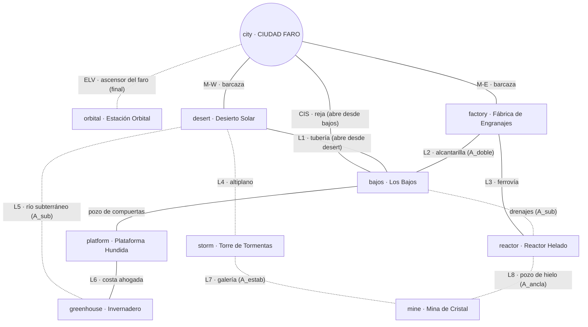
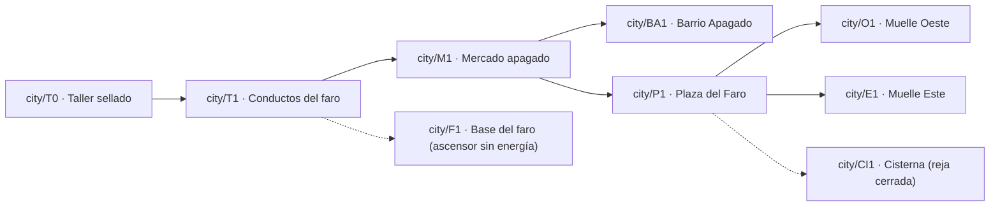
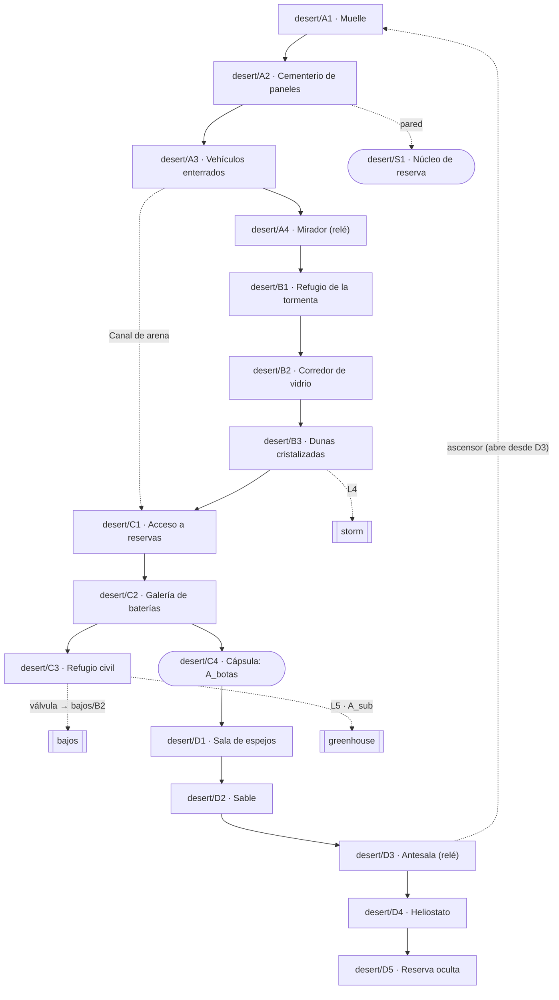

# Issue #1 — Topología del mundo interconectado

**Versión:** 2 (corrige la revisión de ChatGPT en la PR #3; el detalle está en la sección 11).
**Estado:** propuesta para revisión (ChatGPT) y aprobación (usuario).
**Alcance:** solo diseño. No modifica `index.html`, sistemas jugables ni guardados.
**Inspiración:** principios de exploración de los Metroidvania (mundo continuo, atajos que se abren desde el otro lado, regreso con habilidades nuevas, lugares vistos antes de poder alcanzarlos). No se copian mapas, personajes, arte ni contenido de ningún juego.

---

## 0. Convenciones y principios

### 0.1 Identificadores
- **Regiones:** `city`, `desert`, `bajos`, `factory`, `platform`, `reactor`, `greenhouse`, `storm`, `mine`, `orbital`.
- **Salas:** `región/código`, por ejemplo `city/P1`, `desert/C3`, `bajos/B4`. Ningún código se repite dentro de su región.
- **Conexiones entre regiones:** `link/L1` … `link/L8` (laterales) y `link/M-W`, `link/M-E`, `link/CIS`, `link/ELV` (desde la ciudad).
- **Circuitos de retorno:** `loop-west`, `loop-east`, `loop-north`, `loop-south`.
- **Habilidades:** `A_botas`, `A_doble`, `A_sub`, `A_ancla`, `A_linterna`, `A_estab`. **Objeto de progresión:** `K_llave`.
- **Banderas de mundo:** ver sección 4.1.

### 0.2 Principios
1. **La ciudad está en el centro y debajo de todo.** Es el punto de partida, el lugar al que se vuelve y la llave final.
2. **Cada región tiene al menos dos entradas.** *Excepción intencional:* `orbital`, que es el clímax y tiene una sola entrada (`link/ELV`, el ascensor del faro). Su salida es el mismo ascensor.
3. **Los atajos se abren desde el lado difícil.** Se marcan como `abre-desde: <sala>` en las tablas.
4. **Mostrar antes de permitir.** Cada habilidad nueva debería hacer recordar al menos un lugar visto antes.
5. **Habilidades centrales para avanzar; armas para explorar.** Ninguna ruta obligatoria exige el arma de un guardián.
6. **Nada se cierra sin salida.** Toda caída de un solo sentido tiene salida con las habilidades disponibles en ese punto.

---

## 1. Geografía y topología del mundo

### 1.1 Geografía
- **`city` · Ciudad Faro:** flota en el centro del mar, anclada sobre ruinas sumergidas.
- **Oeste · `desert`:** la meseta del Desierto Solar. Al norte se alza la Torre de Tormentas (`storm`), que provoca la tormenta de vidrio del desierto.
- **Este · `factory`:** la isla industrial de la Fábrica de Engranajes. Una ferrovía de carga sube al noreste, hasta el Reactor Helado (`reactor`).
- **Debajo de la ciudad · `bajos`:** Los Bajos, las calles y cisternas de la ciudad vieja sobre la que flota Ciudad Faro. Tiene pasarelas **secas** sobre canales y depósitos **inundados**.
- **Sur, bajo el mar · `platform`:** la Plataforma Hundida. Su cubierta superior está seca; el resto, inundado.
- **Suroeste · `greenhouse`:** el Invernadero Biomecánico, en una costa ahogada.
- **Norte · `mine`:** la Mina de Cristal, entre la Torre y el Reactor.
- **Arriba · `orbital`:** la Estación Orbital, por el ascensor del faro.

### 1.2 Diagrama de regiones

Línea continua: accesible con el kit base (puede requerir una bandera). Línea punteada: exige una habilidad avanzada.

### 1.3 Tabla de conexiones entre regiones
| ID | Origen ↔ destino | Requisito | Dirección | Tipo | Propósito |
|---|---|---|---|---|---|
| `link/M-W` | `city/O1` ↔ `desert/A1` | `F_intro` | Ambos sentidos | Obligatoria | Primera salida |
| `link/M-E` | `city/E1` ↔ `factory/F1` | `F_intro` | Ambos sentidos | Obligatoria (diseño final) | Segunda región inicial |
| `link/CIS` | `city/CI1` ↔ `bajos/B1` | `F_reja` | Abre-desde: `bajos/B1` | Opcional (atajo) | Atajo urbano |
| `link/L1` | `desert/C3` ↔ `bajos/B2` | `F_valvula` | Abre-desde: `desert/C3` | Opcional (atajo) | `loop-west` |
| `link/L2` | `factory/F4` ↔ `bajos/B5` | `A_doble` | Ambos sentidos | Opcional | Acceso este a Los Bajos |
| `link/L3` | `factory/F6` ↔ `reactor/R1` | `A_doble` **o** `F_fabrica` | Ambos sentidos (vagón) | Obligatoria para el norte por este lado | Tercera región |
| — | `bajos/B4` ↔ `platform/P1` | Ninguno (bajada seca) | Ambos sentidos | Obligatoria para `platform` | Región marina |
| — | `bajos/B6` ↔ `reactor/R3` | `A_sub` | Ambos sentidos | Opcional (segunda entrada) | `loop-east` |
| `link/L4` | `desert/B3` ↔ `storm/T1` | (`A_doble` y `A_botas`) **o** `A_ancla` | Ambos sentidos | Obligatoria para `storm` | Región avanzada |
| `link/L5` | `desert/C3` ↔ `greenhouse/G4` | `A_sub` | Ambos sentidos | Opcional (segunda entrada) | `loop-south` |
| `link/L6` | `platform/P1` ↔ `greenhouse/G1` | Ninguno (costa seca) | Ambos sentidos | Obligatoria para `greenhouse` | Acceso principal |
| `link/L7` | `storm/T5` ↔ `mine/N1` | `A_estab` | Ambos sentidos | Una de dos entradas | Zona final |
| `link/L8` | `reactor/R5` ↔ `mine/N2` | `A_ancla` | Ambos sentidos | Una de dos entradas | Zona final |
| `link/ELV` | `city/F1` ↔ `orbital/O1` | `A_estab` y `K_llave` | Ambos sentidos | Obligatoria (final) | Clímax |

Son **8 conexiones laterales** (`link/L1`–`L8`).

### 1.4 Circuitos de retorno
| ID | Recorrido | Se cierra con | Para qué sirve |
|---|---|---|---|
| `loop-west` | `city` → M-W → `desert` → L1 → `bajos` → CIS → `city` | `F_valvula` + `F_reja` | Primer gran atajo; une la ciudad con el corazón del desierto sin barcaza |
| `loop-east` | `city` → M-E → `factory` → L3 → `reactor` → drenajes → `bajos` → CIS → `city` | `A_sub` (+ `F_reja`) | Une las regiones industriales y muestra que Los Bajos están bajo todo |
| `loop-north` | `desert` → L4 → `storm` → L7 → `mine` → L8 → `reactor` → L3 → `factory` → M-E → `city` | `A_estab` + `A_ancla` | Gran vuelta por el norte; la tormenta y el hielo comparten causa |
| `loop-south` | `bajos` → `platform` → L6 → `greenhouse` → L5 → `desert` | `A_sub` | Une el mar con el desierto |

### 1.5 Relés del faro (puntos de control y viaje rápido)
Cada relé reactivado es punto de control y destino de viaje rápido hacia otros relés activos. También le transmite el contorno de la región al mapa.

| Relé | Sala | Alcanzable cuando… |
|---|---|---|
| `relay/plaza` | `city/P1` | Desde la introducción |
| `relay/mirador` | `desert/A4` | Al llegar al desierto |
| `relay/corazon` | `desert/D3` | Tras cruzar la sala de espejos (`A_botas`) |
| `relay/colector` | `bajos/B3` | Al entrar a Los Bajos |
| `relay/hangar` | `platform/P2` | Al llegar al hangar de presión |
| (uno o dos por región restante) | — | Se definirán con cada región |

**Los Bajos no son una autopista:** tiene un solo relé (`relay/colector`) y sus pasarelas obligan a cruzar salas con enemigos propios. El viaje rápido nunca conecta dos puntos de Los Bajos.

---

## 2. Los Bajos (región conectora)

### 2.1 Identidad
Las calles de la ciudad vieja, hundidas bajo Ciudad Faro. Faroles apagados bajo el agua, letreros de comercios que ya no existen y gente que vive abajo porque arriba no hay lugar. Tiene enemigos propios (bombas de achique que se volvieron agresivas, cangrejos de mantenimiento) y una historia de habitantes: una comunidad que no aparece en el censo de la ciudad.

### 2.2 Salas: secas e inundadas
| Sala | Estado | Conecta con | Requisito |
|---|---|---|---|
| `bajos/B1` · Cisterna | **Seca** | `city/CI1` (reja), `bajos/B3` | La reja se abre desde aquí (`F_reja`) |
| `bajos/B2` · Galería de válvulas | **Seca** | `desert/C3` (tubería L1), `bajos/B3` | `F_valvula` |
| `bajos/B3` · Colector central (relé) | **Seca** (pasarelas sobre el canal) | B1, B2, B4, B5, B6 | — |
| `bajos/B4` · Pozo de compuertas | **Seca** (bajada con plataformas) | B3, `platform/P1` | — |
| `bajos/B5` · Alcantarilla de escoria | **Seca** (pozo vertical) | B3, `factory/F4` (L2) | `A_doble` para subir hacia la Fábrica |
| `bajos/B6` · Depósito inundado | **Inundada** | B3, `reactor/R3` (drenajes) | `A_sub` |

---

## 3. Ciudad Faro introductoria

### 3.1 Salas


| Sala | Qué pasa | Enseña | Gancho / recompensa |
|---|---|---|---|
| `city/T0` · Taller sellado | El piloto despierta en el taller abandonado de la ingeniera, bajo el faro. La armadura se activa por primera vez durante un apagón. | Correr, saltar | Grabación de la ingeniera cortada a la mitad |
| `city/T1` · Conductos del faro | Salida vertical. Se ve a lo lejos el ascensor del faro sin energía (`city/F1`). | Pared, impulso de pared | "Algún día ese ascensor tendrá que funcionar" |
| `city/M1` · Mercado apagado | Un dron de mantenimiento infectado ataca puestos vacíos. | Disparar, disparo cargado | Aparece el **Decodificador** (personaje en validación, sección 9) |
| `city/BA1` · Barrio Apagado | La familia de Lira vive a oscuras. **Aquí se conoce a Lira en persona**; hasta ese momento solo se la oyó por radio. | Dash (hueco corto) | «No, no estoy llorando. Es el humo del generador.» |
| `city/P1` · Plaza del Faro | El faro parpadea. Lira explica la situación de las estaciones y recomienda el desierto, sin bloquear la fábrica. | — | `relay/plaza`. Se activa `F_intro` |
| `city/O1` · Muelle Oeste | Barcaza al Desierto Solar | — | Recomendado ("la más cercana y la menos rara") |
| `city/E1` · Muelle Este | Barcaza a la Fábrica | — | Disponible, con aviso de mayor peligro |
| `city/CI1` · Cisterna | Reja oxidada; se oye agua y se ve una luz cian del otro lado | — | Se abre desde `bajos/B1` |

Para no saturar la introducción, solo aparecen Lira y el Decodificador. Los demás personajes nuevos llegan después.

### 3.2 Cambios visibles al regresar (por estado)
| Estado | Cambio en la ciudad |
|---|---|
| `F_desierto = pendiente` (se salió del desierto sin vencer a Heliostato) | La plaza sigue a oscuras. Lira lo comenta («¿Turismo? Bonito momento para conocer las ruinas.»). Nada finge que el desierto esté resuelto |
| `F_desierto = ciudad` | Faroles de la plaza encendidos, el mercado abre, el Barrio Apagado recupera luz. La radio anuncia que un asentamiento "fuera de los registros" perdió suministro |
| `F_desierto = refugio` | Faroles de la plaza encendidos; el barrio sigue a medias. El defensor del refugio aparece en el mercado para cambiar piezas. Lira está molesta, pero entiende |
| `F_paneles` (ver 5.5) | Modula la intensidad: con más paneles intactos, más luces se encienden en cualquiera de las dos opciones |
| `F_fabrica` | Talleres activos; el ascensor de servicio del mercado funciona (atajo interno) |
| `F_reja` | Los vecinos usan el pasaje; un habitante nuevo cuenta historias de Los Bajos |
| Archivista | Primer cameo en la plaza en el **primer regreso** (no en la introducción) |

---

## 4. Grafo de progresión: salas, requisitos y banderas

### 4.1 Banderas de mundo
| Bandera | Se activa en | Valores |
|---|---|---|
| `F_intro` | Fin de la introducción (`city/P1`) | sí / no |
| `F_valvula` | Palanca en `desert/C3` | sí / no |
| `F_reja` | Palanca en `bajos/B1` | sí / no |
| `F_ascensor_d3` | Palanca en `desert/D3` (ascensor a `desert/A1`) | sí / no |
| `F_desierto` | Al vencer a Heliostato y decidir | `pendiente` / `ciudad` / `refugio` |
| `F_paneles` | Al terminar la pelea con Heliostato | 0–4 paneles intactos |
| `F_fabrica` | Al vencer a Horologio | sí / no |
| `F_sable` | Encuentros con Sable (sección 6) | 0 / 1 / 2 … |
| `F_tarjeta` | Recoger la tarjeta de Sable en `desert/D2` | sí / no |

### 4.2 Adyacencias de las regiones del primer hito
**`city`**
| Sala | Conecta con | Requisito |
|---|---|---|
| `city/T0` | `city/T1` | — |
| `city/T1` | `city/M1`; vista de `city/F1` | Pared |
| `city/M1` | `city/BA1`, `city/P1` | — |
| `city/P1` | `city/O1`, `city/E1`, `city/CI1`, `city/F1` | `F_intro` para los muelles |
| `city/CI1` | `bajos/B1` | `F_reja` |
| `city/F1` | `orbital/O1` | `A_estab` y `K_llave` |

**`desert`**
| Sala | Conecta con | Requisito | Nota |
|---|---|---|---|
| `desert/A1` | `city/O1`, `desert/A2`, `desert/D3` | `F_ascensor_d3` para D3 | Muelle de llegada |
| `desert/A2` | `desert/A3`, `desert/S1` | Pared para S1 | Núcleo de reserva |
| `desert/A3` | `desert/A4`, `desert/C1` (Canal de arena) | Disparo cargado rompe la grieta | Ruta oculta |
| `desert/A4` | `desert/B1` | — | `relay/mirador`; meseta con torretas |
| `desert/B1` | `desert/B2` | — | Refugio de la tormenta; silueta de Sable |
| `desert/B2` | `desert/B3` | — | Corredor de vidrio (viento, pinchos) |
| `desert/B3` | `desert/C1`, `storm/T1` | (`A_doble` y `A_botas`) o `A_ancla` para `storm` | Dunas cristalizadas |
| `desert/C1` | `desert/C2` | — | Acceso a reservas |
| `desert/C2` | `desert/C3`, `desert/C4` | — | Galería de baterías |
| `desert/C3` | `bajos/B2`, `greenhouse/G4` | `F_valvula`; `A_sub` | Refugio civil, robot farolero, defensor del refugio |
| `desert/C4` | `desert/D1` | — | **Cápsula: `A_botas`** |
| `desert/D1` | `desert/D2` | `A_botas` | Sala de espejos |
| `desert/D2` | `desert/D3` | — | Encuentro con Sable |
| `desert/D3` | `desert/D4`, `desert/A1` | Palanca abre el ascensor (`F_ascensor_d3`) | `relay/corazon` |
| `desert/D4` | `desert/D5` | Vencer a Heliostato | Arena |
| `desert/D5` | `desert/D3` | — | Revelación y decisión |

**`bajos`**: ver la tabla 2.2.

**`platform`** (solo lo necesario para la progresión)
| Sala | Estado | Conecta con | Requisito |
|---|---|---|---|
| `platform/P1` · Cubierta superior | Seca | `bajos/B4`, `platform/P2`, `greenhouse/G1` | — |
| `platform/P2` · Hangar de presión | Seca | `platform/P1`, `platform/P3` | — · **obtiene `A_sub`** · `relay/hangar` |
| `platform/P3+` · Niveles inundados | Inundada | `platform/P2`, guarida de Nereida | `A_sub` |

### 4.3 Habilidades: dónde se obtienen y cómo se llega
| Habilidad | Sala | Ruta mínima desde el inicio | Rutas alternativas |
|---|---|---|---|
| `A_botas` | `desert/C4` | `city` → M-W → A1…C2 → C4 | Canal de arena (A3 → C1) |
| `A_doble` | `factory` (núcleo de talleres) | `city` → M-E → Fábrica | — |
| `A_sub` | `platform/P2` | `desert/C3` (`F_valvula`) → `bajos/B2` → B3 → B4 → `platform/P1` → P2 | Por la Fábrica: `A_doble` → L2 → `bajos/B5` → B3 → B4 → P1 → P2 |
| `A_ancla` | `reactor` | `factory` → L3 (`A_doble` o `F_fabrica`) | `bajos/B6` drenajes (`A_sub`) |
| `A_linterna` | `greenhouse` | `platform/P1` → L6 → `greenhouse/G1` | `desert/C3` → L5 (`A_sub`) |
| `A_estab` | `storm` | `desert/B3` → L4 ((`A_doble` y `A_botas`) o `A_ancla`) | — |
| `K_llave` | Núcleo de `mine` (exige `A_linterna`) | `storm` → L7 (`A_estab`) | `reactor` → L8 (`A_ancla`) |

**`A_linterna`** no es un dispositivo nuevo: es un **modo de la mochila-faro canónica**. El núcleo de la linterna aprende una frecuencia de resonancia de la tecnología bioluminiscente de Vesper, que disuelve los velos del Eco.

### 4.4 Comprobación de dependencias (sin ciclos)
```
Base ─┬─► A_botas            (desert/C4)
      ├─► A_doble            (factory)
      └─► F_valvula ──► A_sub (platform/P2)        [ruta alternativa: A_doble → L2]
A_doble ∨ F_fabrica ∨ A_sub ─► A_ancla            (reactor)
F_valvula ∨ A_doble ─► platform/P1 ─► A_linterna   (greenhouse por L6)
(A_doble ∧ A_botas) ∨ A_ancla ─► A_estab           (storm)
(A_estab ∨ A_ancla) ∧ A_linterna ─► K_llave        (mine)
A_estab ∧ K_llave ─► orbital
```
Las banderas de acceso (`F_valvula`, `F_fabrica`) se obtienen solo con el kit base, así que ninguna habilidad depende de otra que se consiga después.

### 4.5 Recorridos demostrables
**Recorrido 1 · Orden A, hasta la movilidad submarina y de regreso**
1. `city/T0` → T1 → M1 → BA1 → P1 (`F_intro`) → O1 → M-W.
2. `desert/A1` → A2 → A3 → A4 → B1 → B2 → B3 → C1 → C2 → C3 (abre `F_valvula`) → C2 → C4 (`A_botas`) → D1 → D2 (Sable) → D3 (`F_ascensor_d3`) → D4 (Heliostato) → D5 (`F_desierto`, `F_paneles`).
3. D5 → D3 → ascensor → A1 → M-W → `city` (cambios visibles), **o** D3 → … → C3 → L1 → `bajos/B2` → B3 → B4 → `platform/P1` → P2 (`A_sub`).
4. **Regreso desde la Plataforma:** P2 → P1 → `bajos/B4` → B3 → B1 (abre `F_reja`) → `city/CI1` → `city/P1`.

**Recorrido 2 · Saltarse a Heliostato (intencional, ver 5.6)**
`desert/C3` (`F_valvula`) → `bajos` → `platform/P2` (`A_sub`) → `platform/P1` → L6 → `greenhouse` (`A_linterna`). `F_desierto` sigue en `pendiente`.

**Recorrido 3 · Orden B**
`city/P1` → M-E → `factory` (`A_doble`, `F_fabrica`) → M-E → `city` → M-W → `desert` (completo, con el mirador del altiplano ya alcanzable).

### 4.6 Reglas para evitar bloqueos
1. Toda ruta obligatoria usa solo habilidades centrales y banderas que se obtienen con ellas.
2. Puertas, atajos y palancas quedan abiertos para siempre (se guardan).
3. Toda caída de un solo sentido tiene salida con las habilidades de ese momento.
4. Las arenas de jefe tienen salida después de la pelea.
5. Guardado automático al obtener una habilidad o activar una bandera de acceso.
6. **Validador de rutas** (Fase 1): recorre el grafo de esta sección para cada conjunto de habilidades y banderas, y comprueba que toda sala obligatoria sea alcanzable y tenga regreso a un relé.

---

## 5. Desierto Solar reestructurado

### 5.1 Diagrama

Se conservan las cuatro áreas y lo que ya existe en el juego: huecos, meseta con torretas (`desert/A4`), campo de pinchos (`desert/B2`), Núcleo de reserva en la pared (`desert/S1`), cápsula de las Botas (movida a `desert/C4`) y arena de Heliostato (`desert/D4`).

### 5.2 Secretos con contenido
| Secreto | Dónde | Requisito | Qué aporta |
|---|---|---|---|
| Núcleo de reserva | `desert/S1` | Pared | +4 energía máxima (ya existe en el juego) |
| Grabación de la ingeniera #1 | Camión enterrado en `desert/A3` | Rayo Solar | Primera pista de que las estaciones eran más que energía |
| Fragmento 1 | Bajo las dunas de `desert/B3` | `A_botas` | Primer fragmento del protocolo de Madre Faro |
| Diario del robot farolero | `desert/C3` | Hablar con él en tres visitas | Historia de la niña que esperaba; momento sin bromas |
| Cámara de vidrio sellada | Junto a `desert/C2` | Rayo Solar | Mejora de energía de arma |
| Mirador del altiplano | Arriba de `desert/B3` | `A_doble` | Vista de la Torre de Tormentas antes de poder ir |

### 5.3 Tiempos estimados
| Tramo | Ruta crítica | Exploración opcional |
|---|---|---|
| Ciudad introductoria (`city/T0`–P1) | 8–10 min | 2–4 min |
| Desierto, áreas A y B | 7–9 min | 4–6 min |
| Desierto, área C (incluye Botas) | 5–7 min | 3–5 min |
| Desierto, área D (Sable y Heliostato) | 8–10 min | 1–2 min |
| Tramo de Los Bajos (C3 → Cisterna) | 3–4 min | 1–2 min |
| Regreso y cambios en la ciudad | 3–5 min | 2–3 min |
| **Total del hito** | **34–45 min** | **+13–22 min** |

El objetivo pasa a ser **35–45 minutos de ruta crítica** y **50–65 minutos con exploración**. Esto corrige la cifra de 25–40 minutos para el desierto solo (ahora 20–26 de ruta crítica) y la meta anterior de 30–45 para todo el hito.

### 5.4 Heliostato: fases
- **Fase 1:** salto con ondas, abanico y embestida (los actuales), con mejor anticipación visual y sonora.
- **Fase 2 (50 % de vida):** los 4 paneles de la arena concentran rayos. Destruir un panel debilita esos ataques.

### 5.5 Paneles y energía: avisar antes de decidir
**Dos variables:** `F_paneles` (0–4 paneles intactos) y `F_desierto` (`ciudad` / `refugio`).

**Cómo se avisa al jugador, antes y durante la pelea:**
1. En `desert/D3`, una placa de mantenimiento legible dice que los paneles de la arena alimentan la reserva.
2. Al empezar la fase 2, un medidor visible indica **"Reserva recuperable: 100 %"** y baja un 25 % por cada panel destruido.
3. Al romper el primer panel, Lira por radio: «Cada panel que rompes es luz que no vuelve. Lo digo para que lo sepas, no para que te mueras.»

**Efecto combinado (sin castigar a nadie):**
| Paneles intactos | `F_desierto = ciudad` | `F_desierto = refugio` |
|---|---|---|
| 4 | Ciudad totalmente iluminada; mejora extra de energía en el taller | Refugio estable y plaza encendida; mejora extra en el taller |
| 1–3 | Ciudad iluminada salvo un sector | Refugio estable; la plaza a medias |
| 0 | La plaza se enciende, el barrio no | El refugio sobrevive con lo mínimo; la plaza se enciende |

Ningún contenido obligatorio depende de los paneles. Solo cambia la intensidad de las consecuencias y una mejora opcional.

### 5.6 Saltarse a Heliostato: decisión de diseño
**Es intencional.** Abrir la válvula de `desert/C3` antes del jefe permite ir a Los Bajos, la Plataforma, el Invernadero e incluso el Reactor (con `A_sub`). Es una virtud propia de un Metroidvania.

**Qué queda pendiente mientras `F_desierto = pendiente`:**
- La arena de Heliostato, la revelación de `desert/D5` y la decisión siguen esperando.
- La ciudad no cambia por el desierto (tabla 3.2).
- El defensor del refugio se queda en `desert/C3`: su escena inicial ocurre, la final no.
- Los guardianes posteriores mencionan que el desierto sigue apagado (líneas variantes).
- El hito «La primera luz» exige vencer a Heliostato para considerarse completo; el salto existe, pero no cuenta como final del hito.

---

## 6. Sable: estados de evento para cualquier orden

**Regla:** el **primer guardián cuya antesala alcance el jugador** dispara la presentación de Sable. El siguiente dispara el reconocimiento. No se duplican cinemáticas: cada antesala tiene **una escena** con variantes de diálogo según `F_sable`.

| `F_sable` | Escena | Dónde | Contenido |
|---|---|---|---|
| 0 → 1 | **Presentación** | Antesala del primer guardián (`desert/D2`, la de la Fábrica o la de otra región) | Sable se presenta, explica su miedo en una línea, duelo corto no letal |
| 1 → 2 | **Reconocimiento** | Antesala del segundo guardián | «Otra vez tú.» Duelo con un patrón nuevo; menciona lo que el jugador hizo en la región anterior |
| 2+ | Recurrente | Según la campaña | Por definir con cada región |

**Variantes de `desert/D2`:**
- **Presentación** (el desierto es el primer guardián):
  > **Sable:** Cada vez que alguien "arregla" una estación, alguien más deja de respirar. Pregúntale a tu técnica por qué no te lo dijo.
  > **Piloto:** No tengo jefa. Tengo una técnica con mal humor y un sueldo inexistente.
- **Reconocimiento** (el jugador ya venció a Horologio):
  > **Sable:** Horologio fabricaba manos para muertos. Y aun así lo apagaste. ¿Qué vas a hacer con algo que todavía protege a vivos?
- **La tarjeta del refugio** (`F_tarjeta`) se entrega en **ambas variantes**, porque pertenece al desierto. Si se recoge, cambia el diálogo de `desert/D5`.
- **Presagio:** la silueta de Sable en `desert/B1` solo aparece si `F_sable = 0`.

---

## 7. Dos órdenes viables

Ambas regiones iniciales se completan con el kit base, y cada una tiene zonas opcionales que piden la habilidad de la otra.

**Orden A — Desierto primero (orientación suave de Lira)**
- Mecánica: el desierto es abierto y horizontal, ideal para aprender. Las Botas facilitan los pozos de la Fábrica.
- Narrativa: Heliostato plantea la pregunta central (energía para unos o para otros). Horologio después la profundiza con el duelo.

**Orden B — Fábrica primero**
- Mecánica: la Fábrica es vertical y exigente; quien la elige busca desafío. El Doble impulso abre de inmediato el mirador del altiplano.
- Narrativa: primero la tragedia más humana (Horologio); al llegar al desierto, la decisión del refugio pesa más.

Lira **recomienda** el desierto, pero no bloquea la Fábrica. Sus líneas cambian según el orden. Sable se adapta con los estados de la sección 6.

---

## 8. Primer hito jugable: «La primera luz»

**Distinción importante:** el hito es una **demo de producción**; el diseño final es el de las secciones 1 a 7.

| Elemento | Hito | Diseño final |
|---|---|---|
| Muelle Este | "Barcaza en reparación" (cierre temporal) | Abierto tras la introducción |
| Los Bajos | Solo `bajos/B1`–B3 y la válvula | Región completa (B1–B6) |
| Regiones | `city` introductoria + `desert` completo | Las diez regiones |

**Contenido:** ciudad introductoria, Desierto Solar completo (A1–D5, S1, C4, Sable, Heliostato con dos fases, decisión), `loop-west` (válvula + reja), regreso con cambios visibles, relés `relay/plaza`, `relay/mirador`, `relay/corazon` y `relay/colector`.

**Criterios de aceptación:**
- Se juega de principio a fin sin bloqueos ni colisiones defectuosas (validador + una partida completa registrada).
- `loop-west` funciona en ambos sentidos.
- Al menos 4 secretos con contenido narrativo o mejora.
- `F_desierto` y `F_paneles` se guardan y cambian la ciudad de forma visible.
- Ruta crítica de 35–45 minutos medida en una partida real.
- Arte de escenarios, enemigos y Heliostato en el estilo del piloto (sin arte provisional en la versión final del hito).

---

## 9. Personajes nuevos (en validación)

El usuario compartió una imagen con cuatro personajes y pidió encontrarles un lugar en la historia. **Los roles de esta tabla son una propuesta de Claude; ni los roles ni los nombres están aprobados.**

| Personaje (por aspecto) | Rol propuesto | Primera aparición propuesta |
|---|---|---|
| Sudadera, lentes, mochila (morado) | **El Decodificador:** escucha las transmisiones del Eco y recibe el mapa de los relés | `city/M1` (introducción) |
| Abrigo de piel (azul) | **Líder del campamento del frío:** su familia está en las cámaras criogénicas de Boreal | `reactor` y la ferrovía |
| Gorro rosado (rojo) | **Defensor del refugio oculto:** pone cara a la decisión del desierto | `desert/C3` |
| Parche y tirantes (verde) | **El Archivista:** custodio de los registros borrados del Consejo; ambiguo | Primer regreso a `city/P1` |

---

## 10. Contradicciones con los documentos actuales (propuestas, sin aplicar)

| # | Documento | Dice hoy | Propuesta |
|---|---|---|---|
| 1 | WORLD_MAP §1 | Progresión ascendente por pares de regiones | Reemplazar por esta topología |
| 2 | DEVELOPMENT_ROADMAP, Fase 3 | La ciudad se construye después del desierto | Mover la ciudad introductoria a la Fase 2 (hito); la Fase 3 queda para la ciudad completa |
| 3 | DEVELOPMENT_ROADMAP / WORLD_MAP §5 | Desierto de 25–40 min; hito de 30–45 min | Desierto: 20–26 min de ruta crítica. Hito: 35–45 min críticos, 50–65 con exploración |
| 4 | WORLD_MAP §3 | Anclajes magnéticos en el taller de Lira tras 4 estaciones | Obtenerlos en el Reactor Helado |
| 5 | WORLD_MAP §5 | Ruta del fondo de C3 al Reactor con Lanza de Escarcha | `desert/C3` conecta con `bajos/B2` (válvula) y `greenhouse` (`A_sub`) |
| 6 | WORLD_MAP §3 | No existe región conectora | Agregar `bajos` |
| 7 | WORLD_MAP §3 | Seis habilidades centrales | Agregar `A_linterna` (modo de la mochila-faro) y `K_llave` |
| 8 | Juego actual (`index.html`) | Menú de selección de 8 estaciones | Viaje físico entre regiones (implementación futura) |
| 9 | Juego actual (`index.html`) | Cápsula de las Botas junto a la puerta del jefe | Moverla a `desert/C4` (implementación futura) |
| 10 | GAME_BIBLE §4 | No incluye a los cuatro personajes nuevos | Agregarlos solo tras aprobación |

---

## 11. Respuesta a la revisión de ChatGPT (PR #3)

| # | Prioridad | Pedido | Cambio en esta versión |
|---|---|---|---|
| 1 | Alta | Progresión real a Los Bajos y `A_sub`; salas secas e inundadas; grafo de salas con banderas; recorrido demostrable y regreso desde la Plataforma | Sección 2 (salas secas/inundadas), 4.1 (banderas), 4.2 (adyacencias con requisitos), 4.3 (rutas mínimas y alternativas), 4.5 (recorridos 1–3 con regreso) |
| 2 | Alta | Definir si se puede saltar a Heliostato y qué cambia | Sección 5.6: intencional, con estado `pendiente` y consecuencias; sin bloqueo artificial |
| 3 | Alta | Sable con ambos órdenes | Sección 6: estados `F_sable`, una escena por antesala con variantes, tarjeta en ambas variantes |
| 4 | Media | Coherencia de tiempos | Sección 5.3: ruta crítica vs. exploración; nueva meta 35–45 / 50–65 min; contradicción #3 |
| 5 | Media | Excepciones y direcciones | Principio 0.2-2 (excepción de `orbital`); tabla 1.3 con dirección, abre-desde, tipo y condición de estado; relés por progreso (1.5) |
| 6 | Media | Paneles con aviso previo y dos variables | Sección 5.5: tres avisos, medidor visible, matriz 3×2 sin contenido obligatorio en juego |
| 7 | Baja | IDs únicos, frase de Lira, linterna, NPC | Convenciones 0.1; Lira en persona en `city/BA1`; `A_linterna` como modo de la mochila-faro; sección 9 reescrita; solo dos personajes en la introducción |
| 8 | Baja | Verificar Mermaid y tablas sin diagrama | Los tres diagramas se renderizaron con `mermaid-cli` 11.4.2 sin errores; tablas de adyacencia en 1.3, 2.2 y 4.2 |
