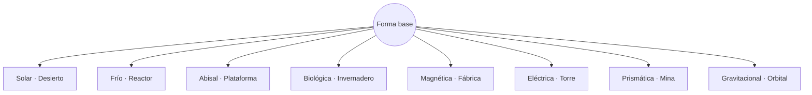
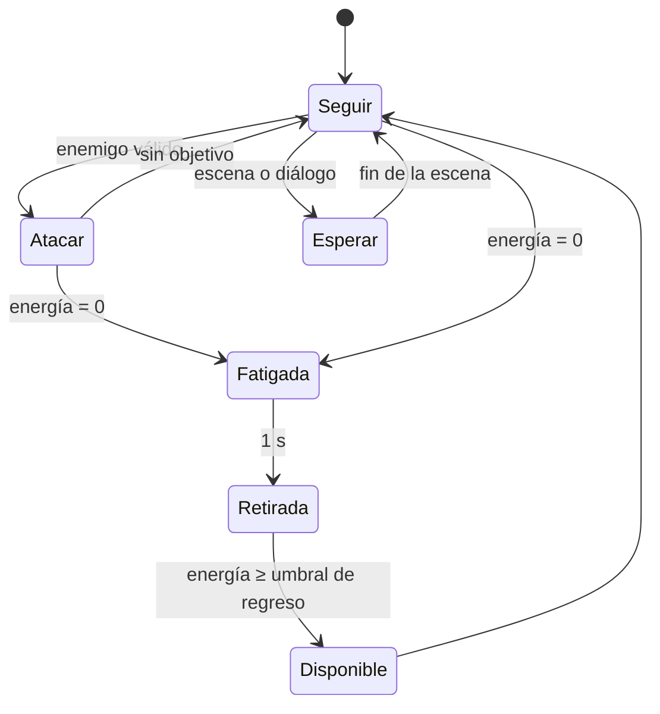

# Issue #5 — Mascotas evolutivas

**Estado:** propuesta para revisión (Chad) y decisión (usuario). Solo diseño: no modifica código, arte, guardados ni `main`.
**Base aprobada por el usuario:** criaturas compañeras originales, encantadoras y con evolución ramificada; combate automático junto al piloto; fatiga y descanso reales; en «La primera luz», **una sola mascota base** (DEVELOPMENT_ROADMAP §2.0b).
**Referencia:** de la idea de una criatura con varias evoluciones (como Eevee) solo se toma el concepto general. No se copian criaturas, siluetas, nombres, movimientos ni diseños de Pokémon.

En este documento: **[Aprobado]** = decidido por el usuario; **[Propuesta]** = idea de Clau o de Chad pendiente de aprobación.

---

## 0. Resumen
- **[Propuesta]** Una criatura flotante, con cola de linterna, que absorbe la energía del entorno y cambia de forma según la energía de cada estación.
- **[Propuesta]** Recomiendo **un solo individuo**, la mascota del piloto, que va desbloqueando formas y puede cambiar entre ellas en los relés. No sería una colección de criaturas.
- **[Aprobado]** Pelea sola, gasta energía, se cansa, se retira y descansa. No puede pelear sin límite.
- **[Aprobado]** Nunca es necesaria para la ruta obligatoria. Sus formas solo abren comodidades y secretos opcionales.
- **[Aprobado]** Primer hito: solo la forma base, sin evoluciones.

---

## 1. Identidad

### 1.1 Concepto visual [Propuesta]
- **Tamaño:** como un gato pequeño (unos 0,6 tiles de alto con la escala de la Fase 1: piloto ≈ 64 px, criatura ≈ 26–30 px).
- **Silueta base, legible a tamaño pequeño:** cuerpo redondo como una gota; ojos grandes y oscuros; **cresta dorsal de aletas translúcidas** que ondula como la de un pez; dos antenas cortas; **cola larga que termina en un bulbo luminoso**, como un pequeño faro.
- **Flota a media altura.** No camina. Se desplaza como un pez en el aire, y la cresta y la cola marcan la dirección.
- **Para alejarse de Pokémon:** sin orejas grandes, sin collar de pelo, sin cuerpo de zorro ni de gato. Los rasgos que la identifican son la gota, la cresta de aletas y la cola-linterna.
- **Paleta base:** gris perla y cian suave, con la luz del bulbo en el mismo cian del visor del piloto. Cada forma cambia la cresta, la cola y el color, pero no la gota ni los ojos, para que siempre se reconozca al mismo individuo.

**Por qué flota (motivo técnico):** una criatura que camina necesita su propia IA de plataformas (saltar huecos, subir paredes, no atascarse), que es cara y fallaría a menudo. Si flota, sigue al piloto sin pathfinding, no se atasca y cuesta muy poco en rendimiento.

### 1.2 Naturaleza y vínculo con el mundo [Propuesta]
- Especie que se adaptó después del Gran Hundimiento: **se alimenta de energía ambiental** y su cuerpo cambia según la energía que absorbe (solar, frío, abisal, biológica, magnética, eléctrica, prismática, gravitacional). Por eso hay una forma por estación.
- Le atrae la **mochila-faro**: su núcleo está aislado de la red, y para la criatura es un lugar cálido y seguro. Cuando se cansa, se esconde ahí.
- **Pista sin revelación:** muy avanzado el juego, un fragmento insinúa que la especie fue diseñada como "bioindicador" de la red de estaciones, el sistema de defensa climática borrado de los registros. Nunca se explica antes de tiempo (regla narrativa 11) y no cambia la trama ni los finales. **Opcional:** si el usuario prefiere, queda sin explicar.
- **No habla.** Se comunica con sonidos, la luz del bulbo y su postura.

### 1.3 Presentación al inicio (sin misión larga) [Propuesta]
1. **`city/T0`, Taller sellado:** al despertar, el piloto encuentra a la criatura dormida dentro de la mochila-faro. La criatura sale, lo mira y vuelve a meterse.
   > **Piloto:** Genial. Me robaron la mochila desde adentro.
2. **`city/T1`:** lo sigue. No hay tutorial: solo se ve que lo acompaña.
3. **`city/M1`, primer combate:** ataca al dron sin que nadie se lo pida. Después de unos ataques se cansa, bosteza y se mete en la mochila. Así se enseña la fatiga sin texto.
   > **Piloto:** Tres golpes y a dormir. Por fin alguien con prioridades claras.
4. **`city/BA1`:** Lila la ve. Una línea suya, sin pausa. Le pone nombre o pregunta cuál es (ver la decisión 5).

Añade segundos, no minutos, a la ruta principal. No crea salas ni banderas de progresión.

### 1.4 Relación con el principio rector
La criatura es alguien a quien cuidar desde el primer minuto: el primer vínculo del piloto antes que la ciudad. El piloto bromea con ella, pero la protege. Nunca hay chistes de alcohol relacionados con ella, y nunca muere ni sufre como recurso dramático.

---

## 2. Evolución ramificada

### 2.1 Organización: tres opciones (decisión del usuario)
| Opción | Cómo funciona | A favor | En contra |
|---|---|---|---|
| **A · Un individuo, formas desbloqueables** (recomendada) | La misma criatura desbloquea formas; en un relé se cambia entre las ya desbloqueadas | Un solo vínculo emocional; nada se pierde; ningún secreto queda inaccesible; guardado simple | Cada forma es menos "definitiva" |
| **B · Un individuo, evolución irreversible** | Se elige una forma y es para siempre | Decisión con peso | Puede dejar secretos opcionales fuera de alcance en esa partida; frustra |
| **C · Colección de criaturas** | Varias criaturas, cada una evoluciona y se elige una activa | Variedad | Diluye el vínculo; mucho más arte, guardado y equilibrio |

**Recomiendo la A:** encaja con el principio rector (una relación, no una colección), evita bloqueos y es la más barata de producir.

### 2.2 Árbol de formas [Propuesta; nombres provisionales]


| Energía · región | Nombre de Chad | Alternativa de Clau | Silueta (sobre la base) | En combate | Apoyo opcional fuera del combate |
|---|---|---|---|---|---|
| Solar · `desert` | Auralis | **Heliet** | La cresta se vuelve espejos pequeños; la cola es una lupa | Rayo corto y concentrado tras un destello de aviso | Ilumina salas oscuras y revela paneles ocultos (secretos) |
| Frío · `reactor` | Glaciel | **Nevil** | Cresta de cristales de hielo; vaho frío | Ralentiza brevemente a un enemigo | Congela goteras para alcanzar cofres opcionales |
| Abisal · `platform` | Nácaro | **Abisín** | Cuerpo con brillo de nácar; cola como farol de pez abisal | Pulso que empuja a enemigos pequeños | Señala bolsas de aire y corrientes con secretos |
| Biológica · `greenhouse` | Vérdel | **Brotal** | Cresta de hojas; brotes en las antenas | Raíces que inmovilizan un instante | Hace crecer brotes que revelan pasajes ocultos opcionales |
| Magnética · `factory` | Ferrux | **Imanto** | Placas metálicas; la cola es un imán | Desactiva un instante torretas pequeñas | Atrae objetos sueltos de la sala |
| Eléctrica · `storm` | Centella | **Chispón** | Cresta en zigzag; chispas | Arco que salta entre dos enemigos | Activa circuitos pequeños opcionales |
| Prismática · `mine` | Irisel | **Prismo** | Cuerpo facetado y translúcido | Un disparo del piloto que la atraviesa se divide en dos | Revela mensajes ocultos en cristales |
| Gravitacional · `orbital` | Gravia | **Cenital** | Anillos que orbitan alrededor | Ralentiza proyectiles cercanos al piloto (por poco tiempo) | Alcanza coleccionables flotantes |

Es una forma por energía de estación, de modo que el árbol acompaña el mundo sin imponer orden: se puede obtener cualquier forma en cuanto se visita su región. La forma gravitacional solo llega al final del juego; es casi una recompensa de cierre.

### 2.3 Cómo se desbloquea una forma [Propuesta]
- En cada región hay un **núcleo de afinidad**: un objeto opcional, escondido pero visible desde algún punto (principio de "ver antes de alcanzar").
- Para que la criatura lo absorba hace falta un **nivel de vínculo** mínimo. El vínculo sube con hitos de exploración (relés activados, regiones visitadas, descansos juntos), **no** con enemigos derrotados, para evitar el farmeo.
- **No depende de vencer al guardián:** se puede desbloquear una forma aunque la estación esté pendiente. Eso respeta la libertad de orden.
- Las formas desbloqueadas son permanentes (opción A). El cambio de forma se hace **solo en relés**.

---

## 3. IA de combate

### 3.1 Estados


| Estado | Comportamiento | Señal para el jugador |
|---|---|---|
| **Seguir** | Flota detrás del piloto, a 1,5–3 tiles y un poco por encima; nunca delante de su línea de disparo | Bulbo encendido suave |
| **Atacar** | Elige un objetivo, se acerca y ataca con aviso previo | El bulbo brilla más antes de cada ataque |
| **Fatigada** | Deja de atacar, sigue despacio, bosteza | Bulbo parpadeando, sonido de cansancio |
| **Retirada** | Se mete en la mochila-faro; no ocupa pantalla | Icono de luna en el anillo de energía |
| **Disponible** | Sale de la mochila y vuelve a Seguir | Destello corto y sonido de "lista" |
| **Esperar** | Durante escenas y diálogos se queda quieta, sin atacar | — |

### 3.2 Reglas de combate [Propuesta; los números son parámetros de balance, no cifras probadas]
- **Objetivo válido:** solo enemigos **dentro de la cámara**, a menos de ~6 tiles del piloto y con línea de visión. Nunca ataca fuera de pantalla.
- **Prioridad:** 1) el enemigo que está preparando un ataque contra el piloto; 2) el último enemigo al que disparó el piloto, para apoyar su decisión; 3) el más cercano al piloto.
- **Ritmo:** aviso de ~0,3 s antes de cada ataque y pausa de 1,5–2,5 s entre ataques.
- **Daño:** un 20–30 % de lo que hace el piloto por segundo. Ayuda; no reemplaza.
- **Jefes:** la mitad de daño, solo durante las aperturas del jefe. No interrumpe patrones ni anula ataques. **Un jefe nunca se puede vencer solo con la mascota**, y Sable y Heliostato siguen siendo los protagonistas de su pelea.
- **No destruye proyectiles** (salvo el efecto breve de la forma gravitacional) y **no bloquea con el cuerpo**: no tiene colisión con el piloto ni con los enemigos.
- **No recibe daño ni muere.** Si un ataque enemigo la alcanza, pierde energía. Así, cansarla es la consecuencia y no hace falta un sistema de muerte de mascota.
- **Visibilidad:** se dibuja detrás del piloto y se atenúa cuando hay muchos efectos en pantalla. No tapa ataques enemigos, avisos ni controles táctiles.

### 3.3 Situaciones especiales
| Situación | Comportamiento |
|---|---|
| Cambio de sala | Pasa con el piloto y conserva su energía |
| Se queda lejos (más de ~12 tiles) o fuera de cámara más de 2 s | Reaparece junto al piloto con un destello |
| Viaje rápido entre relés | Viaja con el piloto |
| Muerte del piloto | Reaparece con él en el relé y recibe la recuperación normal del relé (no es una ventaja: descansar en un relé ya la recupera) |
| Escenas, diálogos, menús | Estado Esperar |
| Agua (zonas inundadas) | Flota igual; con la forma abisal, mejor señalización |

---

## 4. Energía, fatiga y descanso [Propuesta; números a ajustar con pruebas]
| Parámetro | Valor propuesto |
|---|---|
| Energía máxima | 100 |
| Coste por ataque | 8 |
| Golpe recibido | −10 |
| Recuperación pasiva | +1/s, solo **en la mochila** y **sin enemigos en cámara** durante 3 s |
| Tope de la recuperación pasiva | 40 |
| Umbral para volver (Disponible) | 30 |
| Recuperación completa | Relés, refugios (por ejemplo `desert/C3`) y Ciudad Faro, tras una animación corta de descanso (~3 s) |

**Resultado:** con la energía llena da unos 10–12 ataques. Agotada, solo vuelve a pelear con 30–40 de energía (3–5 ataques) y luego se cansa otra vez. Nunca pelea sin límite: necesita descansar de verdad en un punto seguro.

**Contra los trucos:**
- Cambiar de forma solo se puede en un relé, que ya recupera la energía, así que no sirve para reiniciarla.
- Entrar y salir de una sala no la reinicia.
- La energía se guarda; cerrar y abrir el juego no la reinicia.
- La recuperación pasiva tiene tope y no funciona en combate.

**Escena de descanso:** en un relé, la criatura se duerme sobre el regazo del piloto (animación corta, se puede saltar). Funciona junto a la escena 2 de GAME_BIBLE §9 sin restarle silencio.

---

## 5. Metroidvania sin bloqueos
- Las habilidades centrales del piloto siguen bastando para completar el juego (WORLD_MAP §5).
- **Ninguna ruta obligatoria exige la mascota ni una forma concreta.**
- Las formas abren solo comodidades, rutas opcionales y secretos, igual que las armas de los guardianes.
- Todo secreto que necesite una forma muestra una pista (icono en el mapa) y se puede volver con cualquier forma desbloqueada en el relé más cercano.
- El validador de rutas (DEVELOPMENT_ROADMAP §1.7) debe comprobar que la ruta obligatoria sea alcanzable **sin mascota**.
- No cambia la topología: no hacen falta salas ni conexiones nuevas en `WORLD_MAP.md`.

---

## 6. Tiendas (avance para la Issue #6, sin diseñar la economía)
- **Artículo para mascota del puesto de emergencia** [Propuesta]: un bocado que devuelve ~30 de energía fuera de combate. Se llevan 2 como máximo.
- El descanso en los relés **siempre** es gratis y completo, así que los bocados son una comodidad, no un impuesto ni una razón para farmear.
- **Accesorios cosméticos** (collares de luz, colores del bulbo) sin efecto de juego.
- **Sin dinero real:** no hay micropagos ni forma de pagar para ganar.
- Precios, moneda y catálogo: Issue #6.

---

## 7. Implementación futura por fases (solo especificación)

### 7.1 Primer hito «La primera luz»: forma base
- Estados Seguir, Atacar, Fatigada, Retirada, Disponible y Esperar; reglas de §3.2 y §3.3; energía de §4.
- Anillo de energía en el HUD, junto a la vida del piloto, sin botones nuevos en pantalla.
- Guardado versionado (bloque nuevo, con migración desde las partidas actuales):
  ```
  pet: { version: 1, unlocked: true, form: "base", forms: ["base"],
         energy: 0-100, bond: 0, name: "<por decidir>" }
  ```
- Ninguna forma evolucionada, ningún núcleo de afinidad y ningún secreto de mascota.

### 7.2 Hitos posteriores
1. Forma solar y el primer núcleo de afinidad (Desierto), cambio de forma en relés.
2. El resto de las formas, una por región, a medida que existan las regiones.
3. Accesorios y bocados, integrados con la Issue #6.

### 7.3 Arte necesario (estilo HD ilustrado del piloto; lo genera el usuario)
| Recurso | Cuadros aprox. |
|---|---|
| Forma base: flotar/seguir (bucle) | 6–8 |
| Ataque (aviso + disparo) | 5–6 |
| Cansada (bostezo, bucle) | 4 |
| Retirarse a la mochila / salir | 6 + 5 |
| Dormir en un relé (bucle) | 4 |
| Efecto de reaparición | 6 |
| Icono del HUD (anillo, luna) | 2–3 |
| **Total por forma** | **≈ 40** |
| Siete formas evolucionadas | ≈ 280 más (fuera del primer hito) |

### 7.4 Casos de prueba futuros (no ejecutados)
| ID | Prueba | Resultado esperado |
|---|---|---|
| PET-01 | Seguir al piloto corriendo, saltando, con dash y en la pared | Se mantiene a 1,5–3 tiles, sin cruzar su línea de disparo |
| PET-02 | Enemigo fuera de cámara | No lo ataca |
| PET-03 | Varios enemigos, uno preparando un ataque al piloto | Elige ese primero |
| PET-04 | Gastar toda la energía | Fatigada → Retirada en la mochila; deja de atacar |
| PET-05 | Recuperación pasiva | Sube solo sin enemigos en cámara y se detiene en 40; vuelve a 30 |
| PET-06 | Descansar en un relé | Energía a 100 |
| PET-07 | Cambio de sala y viaje rápido | Conserva la energía y llega con el piloto |
| PET-08 | Alejarse más de 12 tiles | Reaparece junto al piloto |
| PET-09 | Muerte del piloto | Reaparece en el relé con recuperación normal |
| PET-10 | Guardar, cerrar, recargar | Energía, forma y vínculo intactos |
| PET-11 | Partida de una versión anterior | Migra con la mascota desbloqueada y energía completa |
| PET-12 | Pelea con Heliostato | La mascota sola no puede vencerlo; no interrumpe patrones |
| PET-13 | Celular en horizontal | No tapa controles ni avisos; 60 FPS con la mascota y 8 enemigos en el dispositivo de referencia |
| PET-14 | Escenas y diálogos | Queda en Esperar |
| PET-15 | Validador de rutas sin mascota | La ruta obligatoria es alcanzable |

---

## 8. Costos y riesgos
| Riesgo | Mitigación |
|---|---|
| La IA de la mascota vuelve trivial el combate | Daño bajo, aviso previo, límite en jefes, fatiga |
| Ruido visual en pantallas pequeñas | Dibujado detrás del piloto, atenuación con efectos, sin botones nuevos |
| Rendimiento en celulares | Flota (sin pathfinding); una sola entidad con máquina de estados simple; prueba PET-13 |
| Volumen de arte (≈ 40 cuadros por forma) | Solo la forma base en el primer hito; las demás, una por región |
| Romper guardados | Bloque `pet` versionado con migración (PET-11) |
| Alargar el hito | La presentación añade segundos y no crea misiones; plan de contingencia de DEVELOPMENT_ROADMAP §2.0b |

---

## 9. Decisiones para el usuario (una sola ronda, después de la revisión de Chad)
1. **Nombre de la especie o forma base:** Núli (Chad) · Fanal (un fanal es la linterna de un faro) · Pabilo (la mecha de una lámpara) · Lumo. Otra opción del usuario también vale.
2. **Organización de la evolución:** A (recomendada) · B · C (§2.1).
3. **Concepto visual base:** criatura flotante con forma de gota, cresta de aletas y cola-linterna (§1.1). ¿Se aprueba como dirección para el arte?
4. **Nombres de las ocho formas:** los de Chad, mis alternativas o una mezcla (§2.2).
5. **¿El jugador le pone nombre a su mascota** (como al piloto), o tiene un nombre fijo que le da Lila?
6. **Pista sobre el origen** (bioindicador de la red de estaciones, insinuado tarde en un fragmento): ¿se incluye o queda sin explicar (§1.2)?

Los números de §3 y §4 son parámetros de balance propuestos. Se ajustarán con pruebas y no requieren aprobación ahora.
