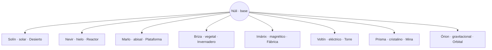
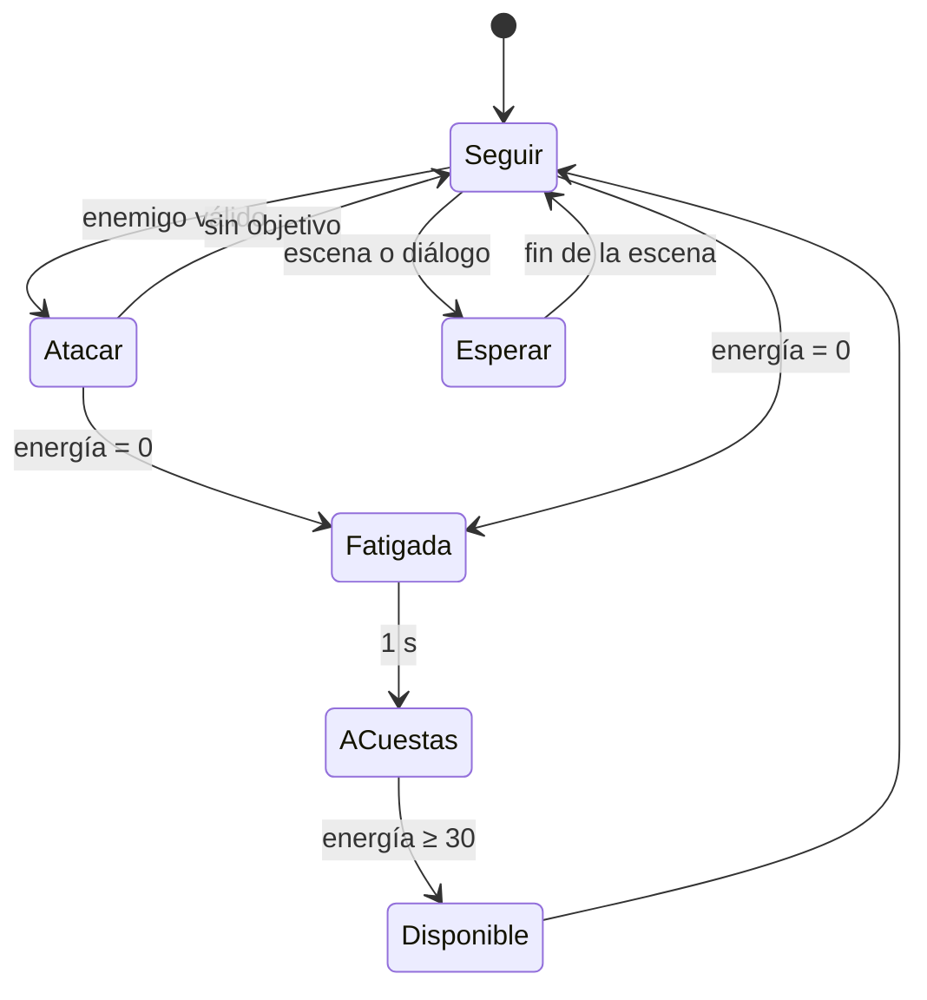

# Issue #5 — Mascotas evolutivas

**Versión:** 3. Integra las cuatro decisiones del usuario del 14-10-2026 (§9) y la última corrección de Chad (§4). El detalle está en §10.
**Estado:** todas las decisiones creativas están aprobadas por el usuario, incluido el nombre del guardián de la Mina, **Espectro**. Los parámetros técnicos siguen siendo propuestas que se ajustarán con pruebas. Pendiente: revisión documental final de Chad y decisión de merge del usuario. Solo diseño: no modifica código, arte, guardados ni `main`.
**Referencia:** de la idea de una criatura con varias evoluciones (como Eevee) solo se toma el concepto general. No se copian criaturas, siluetas, nombres, movimientos ni diseños de Pokémon.

Etiquetas: **[Aprobado]** = decidido por el usuario; **[Propuesta]** = pendiente de aprobación.

---

## 0. Resumen
- **[Aprobado]** Especie **Fanal**; mascota base **Núli**; ocho evoluciones con aspecto y nombre aprobados (§2.2).
- **[Aprobado]** Pelea sola, gasta energía, se cansa y descansa; no puede pelear sin límite.
- **[Aprobado]** En «La primera luz» solo aparece Núli, sin evoluciones.
- **[Aprobado]** Sus habilidades de exploración son opcionales; ninguna ruta obligatoria depende de ella.
- **[Aprobado]** Un solo individuo (opción A) que desbloquea formas permanentes y cambia entre ellas en los relés.
- **[Aprobado]** El jugador puede renombrar a Núli; Lila propone el nombre.
- **[Aprobado]** Pista ambiental opcional y tardía sobre una posible función de bioindicador.
- **[Propuesta]** Camina, corre y salta. Si se atasca o se queda atrás, sigue el rastro del piloto o reaparece a su lado (§3.3).

---

## 1. Identidad

### 1.1 Dirección visual [Aprobado]
El usuario aprobó «tal cual» una lámina ilustrada con Núli y sus ocho evoluciones, generada en la conversación con Chad. **La lámina todavía no está en el repositorio, y Clau no la ha visto.** Esta sección resume la descripción escrita que dejó Chad (comentario en la PR #10). Para reproducirla fielmente, la lámina tendrá que entrar al flujo de arte, con autorización del usuario.

**Núli (forma base):**
- Cuadrúpedo pequeño y adorable, entre criatura costera y faro.
- Pelaje crema, arena y marrón claro.
- Ojos grandes y expresivos.
- Orejas anchas como aletas, con brillos cian.
- Pecho mullido.
- **Cola terminada en un farol luminoso ámbar**: es el rasgo de la especie y se conserva en todas las formas.

**Rasgos comunes a todas las formas:** proporciones, ojos y cola-farol reconocibles, en el estilo 2D HD ilustrado de Ciudad Faro.

La propuesta anterior (una gota flotante) **queda descartada**.

### 1.2 Escala [Propuesta]
Con la escala de la Fase 1 (tile de 24 px, piloto de unos 64 px, ≈ 2,7 tiles):

| Medida | Valor propuesto |
|---|---|
| Alto de Núli, de pie | ≈ 26 px (≈ 1,1 tiles; unos 2/5 del piloto) |
| Largo del cuerpo (sin la cola) | ≈ 30 px |
| Cola con farol | ≈ 16 px más |
| Colisión con el terreno | caja de 18 × 20 px |
| Colisión con el piloto y con los enemigos | ninguna (§3.2) |

**Legibilidad en el celular:** con unos 26 px lógicos, en una pantalla de 6" en horizontal mide alrededor de 1 cm. Es suficiente para leer la silueta y el farol, pero **está sin verificar**: se comprobará en la sala de pruebas de la Fase 1 (caso PET-13). Si no se lee bien, el ajuste será de escala (hasta ≈ 30 px), no de diseño.

### 1.3 Naturaleza y vínculo con el mundo [Propuesta]
- Especie adaptada después del Gran Hundimiento. **Se alimenta de energía ambiental** y su cuerpo cambia según la energía que absorbe; por eso hay una forma por energía de estación.
- Le atrae la **mochila-faro**, cuyo núcleo está aislado de la red: es su lugar cálido y seguro.
- **Pista opcional y tardía [Aprobado]:** un detalle ambiental muy avanzado en el juego insinúa que la especie **pudo** cumplir una función histórica de "bioindicador" de la red de estaciones. Es una insinuación, no un origen definitivo:
  - no es canon que Madre Faro la fabricara;
  - no reescribe a Madre Faro;
  - Núli nunca es una espía;
  - no entra en la trama principal.
- No habla. Se comunica con sonidos, postura y la luz de su farol.

### 1.4 Presentación al inicio (sin misión larga) [Propuesta]
1. **`city/T0`, Taller sellado:** el piloto despierta y encuentra a Núli acurrucada alrededor de la mochila-faro, calentándose con su luz. Aquí se activa `F_nuli`.
   > **Piloto:** Genial. Tengo okupa.
2. **`city/T1`:** lo sigue. No hay tutorial.
3. **`city/M1`, primer combate:** ataca al dron sin que nadie se lo pida. Se cansa, bosteza y se sube a la mochila a dormir. Así se enseña la fatiga sin texto.
   > **Piloto:** Tres golpes y a dormir. Por fin alguien con prioridades claras.
4. **`city/BA1`:** Lila la ve y propone llamarla «Núli». **[Aprobado]** El jugador acepta ese nombre o escribe otro. Los textos del juego usan el nombre elegido; las referencias a la especie (Fanal) y a las formas (Solín, Nevir…) no cambian.

Añade segundos, no minutos, a la ruta principal.

### 1.5 Relación con el principio rector
Núli es alguien a quien cuidar desde el primer minuto: el primer vínculo del piloto antes que la ciudad. El piloto bromea con ella pero la protege. Nunca hay chistes de alcohol relacionados con ella, y nunca muere ni sufre como recurso dramático.

---

## 2. Evolución ramificada

### 2.1 Organización: opción A [Aprobado]

El usuario eligió la **A**: una sola Núli, con ocho formas desbloqueables y permanentes que se alternan en los relés. No hay evolución irreversible ni colección. La tabla queda como registro de las opciones consideradas.

| Opción | Cómo funciona | A favor | En contra |
|---|---|---|---|
| **A · Un individuo, formas desbloqueables** — **elegida** | La misma Núli desbloquea formas; en un relé se cambia entre las desbloqueadas | Un solo vínculo; nada se pierde; ningún secreto queda inaccesible; guardado simple | Cada forma es menos "definitiva" |
| **B · Un individuo, evolución irreversible** | Se elige una forma para siempre | Decisión con peso | Puede dejar secretos opcionales fuera de alcance; frustra |
| **C · Colección** | Varias criaturas Fanal, una activa | Variedad | Diluye el vínculo; mucho más arte, guardado y equilibrio |

### 2.2 Formas: aspecto y nombres aprobados


| Forma **[Aprobado: nombre y aspecto]** | Energía · región | Aspecto (descripción de Chad) | En combate **[Propuesta]** | Apoyo opcional **[Propuesta]** |
|---|---|---|---|---|
| **Solín** | Solar · `desert` | Dorado y ámbar, cresta cálida, cola-farol radiante | Rayo corto concentrado tras un destello de aviso | Ilumina salas oscuras; revela paneles ocultos (secretos) |
| **Nevir** | Hielo · `reactor` | Blanco y azul, rasgos helados, cola luminosa cristalina | Ralentiza brevemente a un enemigo | Congela goteras para alcanzar cofres opcionales |
| **Marlo** | Abisal · `platform` | Turquesa y azul oscuro, aletas acuáticas, farol perlado | Pulso que empuja a enemigos pequeños | Nada en zonas inundadas; señala bolsas de aire y secretos |
| **Briza** | Vegetal · `greenhouse` | Verdes, hojas, flores, cola luminosa floral | Raíces que inmovilizan un instante | Hace crecer brotes que revelan pasajes opcionales |
| **Imánix** | Magnético · `factory` | Gris y cobre, anillos y detalles metálicos | Desactiva un instante torretas pequeñas | Atrae objetos sueltos de la sala |
| **Voltín** | Eléctrico · `storm` | Amarillo y cian, energía y chispas | Arco que salta entre dos enemigos | Activa circuitos pequeños opcionales |
| **Prisma** | Cristalino · `mine` | Blanco iridiscente, rosa y lila, cristales translúcidos | Un disparo del piloto que la atraviesa se divide en dos | Revela mensajes ocultos en cristales |
| **Órion** | Gravitacional · `orbital` | Índigo y plata, anillos flotantes, detalles cósmicos | Ralentiza por poco tiempo los proyectiles cercanos al piloto | Alcanza coleccionables flotantes |

> **Coincidencia de nombres, resuelta por el usuario:** la forma cristalina **conserva el nombre Prisma** y su aspecto aprobado. El **guardián** de la Mina de Cristal pasa a llamarse **Espectro** (aprobado por el usuario, §9).

**Órion [Propuesta]:** se obtiene en la Estación Orbital, la zona final, antes del último jefe. Sirve en el tramo final y en el posjuego, si lo hay. Su arte es el último en producirse.

### 2.3 Cómo se desbloquea una forma [Propuesta]
- Cada región tiene un **núcleo de afinidad** opcional, escondido pero visible desde algún punto.
- Hace falta un **nivel de vínculo** mínimo. El vínculo sube con la exploración (relés activados, regiones visitadas, descansos juntos), **nunca** con enemigos derrotados.
- **No depende de vencer al guardián:** se puede desbloquear una forma aunque la estación esté pendiente.
- Las formas son permanentes (opción A, aprobada) y se cambian **solo en relés**.

---

## 3. IA de combate y movimiento

### 3.1 Estados


| Estado | Comportamiento | Señal para el jugador |
|---|---|---|
| **Seguir** | Camina o corre detrás del piloto, a 1,5–3 tiles; nunca delante de su línea de disparo | Farol encendido suave |
| **Atacar** | Elige un objetivo, se acerca y ataca con aviso previo | El farol brilla más antes de cada ataque |
| **Fatigada** | Deja de atacar, camina despacio, bosteza | Farol parpadeando, sonido de cansancio |
| **A cuestas** | Se sube a la mochila-faro y duerme encima; se mueve con el piloto y no tiene colisión | Icono de luna en el anillo de energía |
| **Disponible** | Baja de la mochila y vuelve a Seguir | Destello corto y sonido de "lista" |
| **Esperar** | En escenas y diálogos se queda quieta, sin atacar | — |

### 3.2 Reglas de combate [Propuesta; los números son hipótesis de balance]
- **Objetivo válido:** solo enemigos **dentro de la cámara**, a menos de ~6 tiles del piloto y con línea de visión.
- **Prioridad:** 1) el enemigo que prepara un ataque contra el piloto; 2) el último enemigo al que disparó el piloto; 3) el más cercano al piloto.
- **Ritmo:** aviso de ~0,3 s y pausa de 1,5–2,5 s entre ataques.
- **Daño:** un 20–30 % de lo que hace el piloto por segundo.
- **Jefes, con reglas comprobables:**
  1. **Ataques no letales:** el daño de Núli nunca baja la vida de un jefe por debajo de 1 punto, ni de un umbral de fase. El golpe final y cada cambio de fase son siempre del piloto.
  2. **Solo en apoyo:** ataca a un jefe únicamente en los 3 s siguientes a un impacto del piloto.
  3. Hace la mitad de daño a los jefes, no interrumpe patrones ni anula ataques.
  4. Caso PET-12.
- **No destruye proyectiles** (salvo el efecto breve de Órion) y **no bloquea con el cuerpo**: no colisiona con el piloto ni con los enemigos.
- **No recibe daño ni muere.** Si un ataque enemigo la alcanza, pierde energía.
- **Visibilidad:** se dibuja detrás del piloto y se atenúa con muchos efectos; no tapa avisos ni controles táctiles.

### 3.3 Movimiento y seguimiento (cuadrúpeda) [Propuesta]
Como camina, necesita seguir al piloto por el terreno sin una IA de plataformas cara. Propongo tres capas, de la más barata a la de emergencia:
1. **Terreno simple:** camina y corre sobre el suelo, salta escalones y huecos de hasta ~2 tiles y cae. Usa la misma colisión de tiles que el piloto, con una caja pequeña.
2. **Rastro del piloto:** el juego guarda las últimas posiciones del piloto (unos 2 s, con pocos puntos). Si el terreno simple no basta (una pared que el piloto trepó, un dash aéreo, un hueco ancho), Núli recorre ese rastro con un "salto de farol": un salto estilizado con una estela ámbar. No necesita pathfinding.
3. **Reaparición:** si queda a más de ~12 tiles, fuera de cámara durante más de 2 s o atascada más de 1 s, reaparece junto al piloto con un destello del farol. Si es posible, lo hace fuera de la vista.

**Rendimiento:** guardar el rastro es un arreglo circular pequeño y el resto son las comprobaciones de colisión que ya hace el piloto. Es una sola entidad más, apta para celular (caso PET-13).

### 3.4 Situaciones especiales
| Situación | Comportamiento |
|---|---|
| Cambio de sala | Pasa con el piloto y conserva su energía |
| Viaje rápido | Viaja con el piloto |
| Muerte del piloto | Reaparece con él en el relé, con la recuperación normal del relé |
| Escenas, diálogos, menús | Esperar |
| Zonas inundadas | Va a cuestas en la mochila mientras el piloto bucea. Con la forma **Marlo**, nada a su lado |
| Paredes y techos (anclajes, trepar) | Capa 2 (rastro) o capa 3 (reaparición) |

---

## 4. Energía, fatiga y descanso [Propuesta; números a ajustar con pruebas]
| Parámetro | Valor propuesto |
|---|---|
| Energía máxima | 100 |
| Coste por ataque | 8 |
| Golpe recibido | −10 |
| Recuperación pasiva | +1/s, solo **a cuestas** y **sin enemigos en cámara** durante 3 s |
| Tope de la recuperación pasiva | 40 |
| Umbral para volver (Disponible) | 30 |
| Recuperación completa | Relés, refugios (por ejemplo `desert/C3`) y Ciudad Faro, tras ~3 s de descanso |

**Ayuda efectiva tras agotarse:**
- Con la energía llena hace unos 12 ataques.
- Agotada, necesita al menos ~33 s de calma para volver con 30–40 de energía, lo que da 3–5 ataques antes de cansarse otra vez.
- **Durante un combate continuo no recupera nada:** la recuperación pasiva exige que no haya enemigos en cámara. Una vez agotada, Núli no vuelve a atacar en esa pelea. Solo regresa tras una pausa realmente segura (sin enemigos en cámara, con 3–5 ataques disponibles) o tras descansar en un relé.
- **Contra un jefe activo no hay ninguna recarga:** la arena siempre tiene al jefe en cámara, así que la mascota ayuda al principio de la pelea y luego descansa a cuestas.
- **Esperar fuera de pantalla está permitido**, pero es lento (~33 s para volver) y tiene tope (40). No sirve para recuperar la energía completa; para eso está el descanso gratuito en los relés.

**Contra los trucos, sin castigar:**
- El descanso completo en relés es gratis y siempre está disponible: no hay nada que "ganarle" al sistema.
- Cambiar de forma solo se puede en un relé, que ya recupera la energía, así que no reinicia nada.
- Entrar y salir de una sala no reinicia la energía, y la energía se guarda: cerrar y abrir el juego tampoco la reinicia.
- Cargar la partida devuelve al último relé, que es lo mismo que descansar.

**Escena de descanso:** en un relé, Núli se duerme en el regazo del piloto (corta y se puede saltar). Es compatible con la escena 2 de GAME_BIBLE §9.

---

## 5. Metroidvania sin bloqueos
- Las habilidades centrales del piloto siguen bastando (WORLD_MAP §5).
- **Ninguna ruta obligatoria exige a Núli ni una forma concreta.**
- Las formas solo abren comodidades, rutas opcionales y secretos.
- Cada secreto que necesita una forma muestra una pista en el mapa, y la forma se cambia en el relé más cercano.
- El validador de rutas (DEVELOPMENT_ROADMAP §1.7) debe comprobar la ruta obligatoria **sin mascota**.
- No cambia la topología de `WORLD_MAP.md`.

---

## 6. Artículo de mascota en el puesto de emergencia (primer hito)
DEVELOPMENT_ROADMAP §2.0b ya aprobó un artículo para la mascota entre los 3–4 del puesto de emergencia de `city/M1`.

**[Propuesta]** **Bocado de farol** (nombre provisional):
- Devuelve ~30 de energía a Núli.
- Solo se usa **fuera de combate**.
- Se llevan 2 como máximo.
- Ni obligatorio ni necesario: el descanso en relés sigue siendo gratis y completo.
- Precio y moneda: Issue #6.

**Fuera del primer hito (Issue #6):** catálogo ampliado, accesorios cosméticos, cuidados. **Sin dinero real:** no hay micropagos ni forma de pagar para ganar.

---

## 7. Implementación futura por fases (solo especificación)

### 7.1 Primer hito «La primera luz»: Núli
- Estados de §3.1, reglas de §3.2, movimiento de §3.3, energía de §4.
- Anillo de energía en el HUD junto a la vida del piloto, sin botones nuevos en pantalla.
- Bocado de farol en el puesto de emergencia (§6).
- Sin evoluciones, sin núcleos de afinidad y sin secretos de mascota.

### 7.2 Guardado y migración [Propuesta]
```
pet: { version: 1, unlocked: false, form: "base", forms: ["base"],
       energy: 100, bond: 0, name: "Núli", introSeen: false }
// name: elegido por el jugador en city/BA1 (por defecto «Núli»).
flags: { F_nuli: false, ... }
```
- **Partida nueva:** `unlocked = false` hasta la escena de `city/T0`, que pone `unlocked = true`, `F_nuli = true` e `introSeen = true`. En `city/M1` Núli ya pelea.
- **Idempotente:** si `introSeen = true`, la escena de `city/T0` no se repite (por ejemplo, al recargar justo después).
- **Partidas de versiones anteriores** (no tienen el bloque `pet`):
  - Si la partida está antes de terminar `city/T0`, se crea el bloque con `unlocked = false` y la presentación ocurre normalmente.
  - Si la partida está más avanzada (`F_intro = true` o cualquier progreso posterior), se crea con `unlocked = true`, `introSeen = false` y energía completa. En el siguiente relé se ve una escena corta, una sola vez: Núli sale de la mochila-faro. Luego `introSeen = true`.
- El mapeo exacto desde el formato del juego actual (menú de 8 estaciones) a las banderas nuevas se define en la Fase 1 (DEVELOPMENT_ROADMAP §1.7).

### 7.3 Hitos posteriores
1. Solín y el primer núcleo de afinidad (Desierto); cambio de forma en relés.
2. Las demás formas, una por región, a medida que existan las regiones; Órion la última.
3. Catálogo de cuidados y accesorios (Issue #6).

### 7.4 Arte necesario (lo genera el usuario a partir de la lámina aprobada)
Cálculo para un cuadrúpedo, por forma:

| Animación | Cuadros aprox. |
|---|---|
| Reposo (bucle) | 4 |
| Caminar | 6–8 |
| Correr | 6–8 |
| Saltar / caer | 3 + 2 |
| Salto de farol (con estela) | 4 |
| Ataque (aviso + golpe) | 5–6 |
| Cansada (bostezo) | 4 |
| Subir a la mochila / bajar | 5 + 4 |
| Dormir a cuestas (bucle) | 4 |
| Dormir en un relé (bucle) | 4 |
| Efecto de reaparición | 6 (compartido) |
| **Total por forma** | **≈ 55** |

| Conjunto | Cuadros aprox. |
|---|---|
| Núli (primer hito) | ≈ 55 + iconos del HUD |
| Ocho formas evolucionadas | ≈ 440 más |
| **Total, nueve formas** | **≈ 495** |

Es una estimación, no un costo confirmado. Puede bajar mucho si las formas comparten esqueleto y poses y solo cambian capas de detalle (orejas, cresta, cola, paleta).

### 7.5 Casos de prueba futuros (no ejecutados)
| ID | Prueba | Resultado esperado |
|---|---|---|
| PET-01 | Seguir al piloto corriendo, saltando, con dash y en la pared | Se mantiene a 1,5–3 tiles, sin cruzar su línea de disparo |
| PET-02 | Enemigo fuera de cámara | No lo ataca |
| PET-03 | Varios enemigos, uno preparando un ataque al piloto | Elige ese primero |
| PET-04 | Gastar toda la energía | Fatigada → a cuestas; deja de atacar |
| PET-05 | Recuperación pasiva | Sube solo sin enemigos en cámara, se detiene en 40 y vuelve con 30 |
| PET-06 | Descansar en un relé | Energía a 100 |
| PET-07 | Cambio de sala y viaje rápido | Conserva la energía y llega con el piloto |
| PET-08 | Alejarse más de 12 tiles | Reaparece junto al piloto |
| PET-09 | Muerte del piloto | Reaparece en el relé con recuperación normal |
| PET-10 | Guardar, cerrar, recargar | Energía, forma, vínculo y nombre intactos |
| PET-11 | Partida de una versión anterior, antes y después de la introducción | Bloque `pet` creado según §7.2; escena de reencuentro una sola vez |
| PET-12 | Heliostato: dejar que Núli ataque sin que el piloto dispare | No ataca al jefe sin un impacto reciente del piloto; nunca le quita el último punto ni provoca un cambio de fase |
| PET-13 | Celular en horizontal | Silueta y farol legibles; no tapa controles ni avisos; 60 FPS con Núli y 8 enemigos en el dispositivo de referencia |
| PET-14 | Escenas y diálogos | Queda en Esperar |
| PET-15 | Validador de rutas sin mascota | La ruta obligatoria es alcanzable |
| PET-16 | El piloto trepa una pared o hace un dash aéreo sobre un hueco ancho | Núli lo alcanza por el rastro o reaparece; nunca queda atascada más de 1 s |
| PET-17 | Recargar justo después de la escena de `city/T0` | La escena no se repite |

---

## 8. Costos y riesgos
| Riesgo | Mitigación |
|---|---|
| Combate trivial | Daño bajo, aviso previo, reglas comprobables en jefes, fatiga |
| Ruido visual en pantallas pequeñas | Dibujada detrás del piloto, atenuación con efectos, sin botones nuevos |
| Atascos de un cuadrúpedo | Tres capas de seguimiento (§3.3); PET-16 |
| Rendimiento en celulares | Una sola entidad; rastro en un arreglo pequeño; PET-13 |
| Volumen de arte (≈ 55 cuadros por forma) | Solo Núli en el primer hito; reutilizar el esqueleto entre formas |
| La lámina no está en el repositorio | Incorporarla al flujo de arte con autorización del usuario antes de producir sprites |
| Romper guardados | Bloque `pet` versionado y migración de §7.2; PET-11 |
| Alargar el hito | La presentación añade segundos; plan de contingencia de DEVELOPMENT_ROADMAP §2.0b |

---

## 9. Decisiones del usuario (14-10-2026)
| # | Decisión | Resultado | Dónde |
|---|---|---|---|
| 1 | Organización de la evolución | **A, aprobada:** una sola Núli, ocho formas desbloqueables y permanentes, cambio en relés | §0, §2.1, §2.3 |
| 2 | ¿El jugador puede renombrar a Núli? | **Sí, aprobado:** Lila propone «Núli»; el jugador acepta o elige otro | §1.4, §7.2 |
| 3 | Pista tardía de "bioindicador" | **Sí, aprobada:** insinuación opcional y tardía; sin canon de origen fabricado por Madre Faro | §1.3 |
| 4 | Coincidencia «Prisma» | **Aprobado:** la forma conserva «Prisma»; el guardián de la Mina se llama **Espectro** | §2.2, GAME_BIBLE §4 |

### Nombre del guardián de la Mina — **Espectro, aprobado por el usuario**
- Un prisma descompone la luz en un espectro: el nombre sigue la línea óptica de Heliostato, Nimbus y Cenit y no se confunde con la forma Prisma.
- "Espectro" también significa fantasma, y encaja con un guardián que conserva memorias de personas muertas.
- Su arma, «Haz Prismático», no cambia.

**No quedan decisiones creativas pendientes en esta Issue.**

Los valores de balance de §3 y §4 siguen siendo hipótesis que se ajustarán con pruebas.

---

## 10. Respuesta a la revisión de Chad y a la decisión visual del usuario
| # | Pedido | Cambio |
|---|---|---|
| Visual | Adaptar a la lámina aprobada (Fanal, Núli y 8 formas) sin rediseñar | §1.1 y §2.2 reescritos; la gota flotante queda descartada; los nombres alternativos se eliminan |
| Visual | Movimiento de un cuadrúpedo sin IA cara | §3.3: tres capas (terreno simple, rastro del piloto, reaparición); estado «a cuestas» en la mochila |
| 1 | Error de escala | §1.2: ≈ 26 px de alto (≈ 1,1 tiles), con la legibilidad pendiente de PET-13 |
| 2 | Conteo de arte (ocho formas) y Órion | §7.4: ≈ 55 cuadros por forma, ≈ 440 para las ocho y ≈ 495 en total; §2.2: Órion en la zona final y en el posjuego |
| 3 | Artículo de mascota en el puesto inicial | §6: bocado de farol en el primer hito; el catálogo ampliado, en la Issue #6 |
| 4 | Desbloqueo, guardado y migración | §7.2: estado inicial, `introSeen` idempotente y migración de partidas anteriores; PET-11 y PET-17 |
| 5 | Garantía de que no vence sola a un jefe | §3.2: daño no letal, sin cambios de fase y solo en apoyo tras un impacto del piloto; PET-12 |
| 6 | Fatiga tras volver con 30–40 | §4: ayuda efectiva acotada, esperar fuera de pantalla permitido pero con tope, sin castigo |
| Final 1 | Frase de recuperación en combate largo | §4: en combate continuo no hay recarga; sin recarga con un jefe activo; descanso gratuito intacto |
| Final 2 | Integrar las cuatro decisiones del usuario | §0, §1.3, §1.4, §2.1, §2.2, §2.3, §7.2 y §9; nombre propuesto para el guardián |
| Final 3 | Ratificación de «Espectro» | Nombre definitivo en GAME_BIBLE §4 y en §2.2 y §9 de este documento; sin decisiones creativas pendientes |
